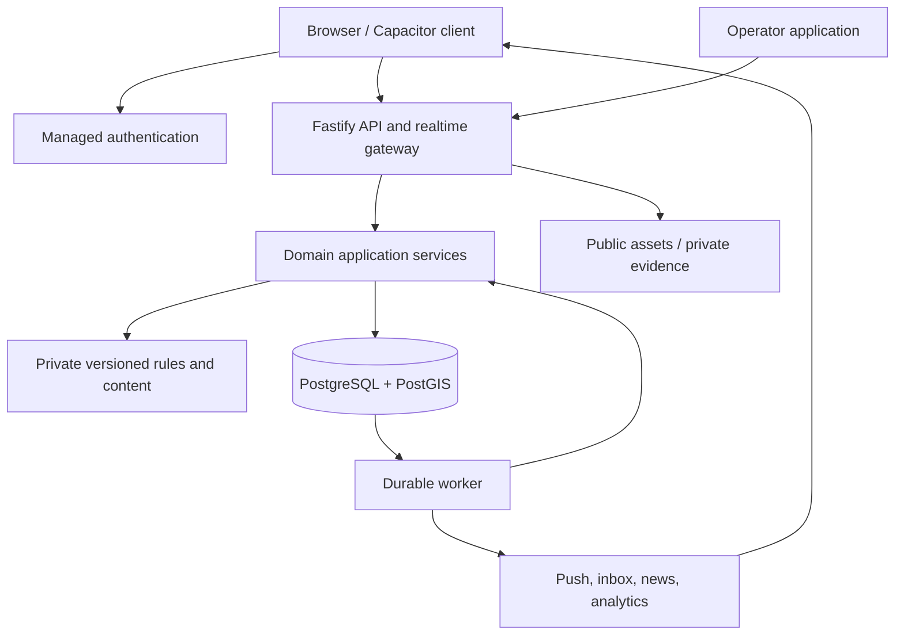
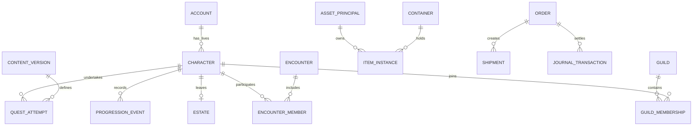

# Hunter World — Master Development Blueprint

## 1. Executive Technical Summary

Build Hunter World as a **persistent, geographically grounded multiplayer game with a server-authoritative economy, character lifecycle, and simulation**.

The recommended foundation is:

- **React, TypeScript, and Vite** for the responsive browser application.
- **Capacitor** to package the same application for Android and iOS.
- **Fastify** for a modular TypeScript backend.
- **PostgreSQL with PostGIS** for authoritative game state, transactions, and geographic queries.
- **Supabase** for managed PostgreSQL, authentication, and object storage.
- **pg-boss** for durable background work.
- **Render** for the persistent API and worker processes.
- **Versioned, server-only content definitions and reusable rules engines** for quests, awakening, NPCs, rewards, and world events.

Use one repository, one authoritative game database, and a modular application with separately deployable API and worker processes. Introduce additional infrastructure only when measurements justify it.

This blueprint is based on all 40 pages of :codex-file-citation{path="C:/Users/aldwi/Downloads/Hunter-World-Final-App-Concept-and-Development-Brief.pdf" purpose="source"}. References such as **Brief §20** identify its numbered design sections. Embedded handoff instructions are treated as document content; this deliverable follows your request to plan without implementing.

The design preserves the features most likely to be lost through oversimplification:

1. Civilian life is a valid career and social identity.
2. Character creation never assigns a combat class.
3. Awakening and hidden discoveries depend on private, consistent server rules.
4. Physical location, virtual position, public visibility, and hostile exposure are separate.
5. Local commerce and remote commerce have different access rules.
6. Permanent death settles property, obligations, leadership, history, and account eligibility.
7. Blood Debt depends on attributable actions, not accusations or a universal kill counter.
8. Guilds, markets, and later governments have powers bounded by server permissions.
9. Ordinary offline characters are sheltered.
10. Content, notifications, and narrative presentation describe authoritative outcomes; they cannot create them.

**Delivery sequence:** secure foundation → persistent solo experience → interconnected multiplayer MVP → complete lifecycle and risk systems → real-device validation → controlled alpha → regional beta → regional production.

No production code, infrastructure, or repository files are created in this planning phase.

---

## 2. Interpretation of the Product

### Product identity

Hunter World is a modern fictional hunter society overlaid on real geography. The player’s phone is their System interface, identification card, map, communications terminal, and access point to encounters.

The player inhabits one living character whose accomplishments, relationships, property, discoveries, and consequences persist. That character may become a hunter, healer, craftsperson, merchant, guild organizer, investigator, or eventually public official.

Combat opens an illustrated tactical environment. It does not require a camera, augmented reality, continuous physical movement, or a real-time action-game engine.

### Complete player journey

1. Create an account and accept the relevant account and location settings.
2. Create one unawakened character with an alias, appearance, and civilian identity.
3. Learn the System, body-status panel, fullscreen ID, map, and community board.
4. Visit a suitable hub or use available remote civilian services.
5. Complete work, gather permitted materials, study, report observations, and meet NPCs.
6. Earn currency, useful items, professional progress, achievements, and relationships.
7. Investigate clues and potentially satisfy an awakening route.
8. Awaken into an eligible class; develop skills and earn role-appropriate certifications.
9. Prepare for Gates independently or with a willing party.
10. Fight, protect, heal, supply, scout, withdraw, rescue, and extract.
11. Use loot personally, craft with it, trade it nearby, deposit it in a market, or sell it remotely.
12. Develop a recognizable role in guilds, commerce, research, and public history.
13. Discover rarer opportunities and participate in larger events.
14. Face permanent consequences when entering declared lethal situations.
15. After finalized death, observe existing history during cooldown and eventually begin a distinct unawakened life.

Remaining unawakened must remain useful throughout this journey.

### Interpretations that resolve ambiguity

| Issue | Adopted interpretation |
|---|---|
| One living character | Both alive and incapacitated characters occupy the account’s living-character slot. |
| Rank and Gate access | Rank usually communicates certification and danger. Only actual entry requirements—keys, seals, capacity, event rules—block entry. |
| Rank and rarity | Hunter rank, item rank, class rarity, item rarity, level, profession credentials, and seasonal standing are separate concepts. |
| Offline shelter | Uncommitted offline characters become sheltered. A committed encounter persists through disconnect under its disclosed rules. |
| Local and remote commerce | Local catalogs require physical proximity. The World Exchange contains goods deliberately listed for remote sale. |
| Posthumous settlement | Completing an obligation earned or funded before death is permitted estate settlement; it is not new gameplay by a dead character. |
| Ownership and custody | A guild owns its loaned equipment; a vendor owns stock held by a market; custody does not transfer ownership automatically. |
| NPC disappearance | Each quest specifies whether it fails, changes completion channel, or settles through an existing obligation. |
| Unique opportunities | Scope and allocation policy must exist before opening the opportunity. Essential roles retain alternative routes. |
| Permanent death and technical faults | Valid gameplay deaths remain permanent. A proven invalid outcome may be corrected only through audited causal reconciliation. |
| History after death | Existing visibility persists. Death does not publish hidden achievements, private builds, real identity, or an automatic obituary. |
| Association Board | The initial board is a system-maintained registry and forum. It does not imply a functioning player government. |

### Planning assumptions

These are proposed defaults, not additional claims from the PDF:

- First production release serves **one configured pilot region**, with up to **200 invited accounts and a test target of 100 concurrent users**.
- Begin infrastructure planning in **Singapore**. Confirm latency from actual pilot testers before provisioning production.
- Use a provisional **adult-only closed test**. Public audience and store requirements are a release review item.
- Support browser, Android, and iOS. Validate Android first; obtain a macOS build environment for iOS.
- Use English initially, while externalizing user-facing strings.
- Use foreground location only. No continuous background tracking is required.
- Use earned currency only for the initial game economy.
- Defer paid cosmetics until gameplay, moderation, and account entitlements are reliable.
- Use authored narrative and deterministic simulation. Runtime LLM dialogue is optional later.
- Keep the commercial name “Hunter World” provisional.

The actual pilot polygon and accessible venues must come from tester access and venue review. The user’s timezone is not evidence of a suitable launch location.

---

## 3. Core Gameplay/Product Loops

| Loop | Actions | Return and connection |
|---|---|---|
| **Minute-to-minute** | Inspect status, read a clue, choose an action, manage equipment, respond to another player. | Produces understandable changes in condition, knowledge, resources, or relationships. |
| **Session** | Select an objective, prepare, undertake work or an encounter, settle results, choose the next objective. | A useful short session can involve commerce or civilian work without combat. |
| **Progression** | Earn experience, develop professions, unlock skills, complete assessments. | Improves capability and recognition without treating purchased equipment as certification. |
| **Economic** | Obtain resources, consume or improve them, trade surplus, fund the next activity. | Connects Gates, civilian contracts, crafting, markets, and guild procurement. |
| **Social** | Meet, exchange information, form parties, trade, recruit, contribute to projects. | Creates trust, recognition, demand, and reasons to return. |
| **Exploration/discovery** | Compare rumors, inspect eligible locations, encounter NPCs, test hypotheses. | Reveals opportunities through consistent clues and recorded actions. |
| **Gate** | Scout → inspect danger → prepare → commit → make tactical decisions → extract or suffer consequences. | Generates loot, injuries, assessments, reports, rescues, and history. |
| **Crafting** | Learn a recipe, source ingredients, secure facilities, produce, inspect quality, use or sell. | Converts encounter output into demand for professions and commerce. |
| **Awakening** | Live as a civilian, accumulate qualifying history, encounter a trigger, receive an authoritative outcome. | Changes capabilities while preserving identity and earlier accomplishments. |
| **Guild** | Recruit complementary members, pool resources, organize expeditions, complete collective objectives. | Builds shared assets and achievements that survive individual leadership changes. |
| **Risk and recovery** | Understand exposure, prepare defenses, retreat or rescue, recover from injuries and strain. | Makes support roles and preparation valuable. |
| **Long-term retention** | Refine a career, gain local recognition, explore new content, participate in seasons and world history. | Creates fresh opportunities without deleting persistent character accomplishments. |

A representative connected session:

> A civilian finds an unusual NPC clue, posts an observation, completes a supply contract, buys a restorative from a local crafter, joins a party as a supplier, helps extract from a Gate, sells materials through the World Exchange, and later encounters an awakening trigger connected to their recorded actions.

The system must recognize supply, protection, healing, research, and rescue as meaningful contributions.

---

## 4. Recommended Technology Stack

### Primary choices

| Area | Recommendation | Why it fits |
|---|---|---|
| Client | React + TypeScript + Vite | Strong fit for maps, forums, inventory screens, and illustrated tactical encounters. Easy to inspect and iterate with Codex. |
| Mobile | Capacitor | Packages the browser application while providing native integrations through explicit adapters. |
| UI | CSS design tokens, CSS Modules, accessible reusable components | Establishes the System aesthetic without requiring a large UI framework or game engine. |
| Routing | React Router | Clear screen boundaries and deep-link handling for both web and packaged mobile clients. |
| Server state | TanStack Query | Query caching and targeted refresh after confirmed actions or realtime events. |
| Local UI state | React state and narrowly scoped context | Avoids copying authoritative inventory or combat state into a competing client store. |
| Backend | Fastify + TypeScript | Explicit validation, domain route boundaries, authentication hooks, and a persistent process suitable for realtime connections. |
| Runtime | Node.js 24 LTS | Supported runtime suitable for the selected TypeScript services. |
| API | Versioned REST/JSON with OpenAPI | Inspectable contracts, generated client types, straightforward integration and mobile compatibility. |
| Validation | JSON Schema with a TypeScript type provider | Shared public contracts without importing server game definitions into clients. |
| Database | PostgreSQL + PostGIS | Transactions, constraints, row locking, geospatial eligibility, relational history, and auditability. |
| Query layer | Drizzle with `node-postgres`; explicit SQL where necessary | Typed ordinary queries while retaining precise control over locks, constraints, and spatial operations. |
| Migrations | Versioned SQL migrations, one canonical migration history | Avoids competing schema-management systems. |
| Authentication | Supabase Auth | Managed authentication while game authorization stays in the application. |
| Object storage | Supabase Storage | Separate public artwork from private evidence and restricted attachments. |
| Jobs | pg-boss | Durable work in the same PostgreSQL environment without requiring Redis initially. |
| Realtime | Authenticated WebSocket notifications from Fastify | Suitable for bounded tactical rounds, party state, trades, and notifications. |
| Maps | MapLibre GL JS + licensed MapTiler tiles | Separates rendering from geographic access decisions and tile licensing. |
| Search | PostgreSQL full-text search and trigram indexes | Sufficient for the initial forums, public discovery, and market queries. |
| Cache | Public static caching and bounded server memory caches | Avoids a separate cache service until measured need. |
| Notifications | Durable in-app inbox; APNs/FCM adapters for mobile | Push supplements persisted state. |
| Observability | Structured logs, OpenTelemetry, Sentry, operational database metrics | Connects an action to its transaction, worker, failure, and user-visible result. |
| Product analytics | Explicit application events and aggregate dashboards | Measures civilian participation, retention, progression, and economic health without recording secret content or precise trails. |
| Hosting | Render API/worker; Supabase database/auth/storage | Managed services with portable application processes and one authority database. |
| CI/CD | GitHub Actions | Reproducible checks, migrations, deployment artifacts, and controlled releases. |
| Tests | Vitest, real PostgreSQL integration tests, Playwright, property tests, load tests | Tests game invariants and actual concurrent behavior rather than only UI success. |

Fastify’s plugin encapsulation supports domain boundaries; it does not require independent microservices. [Fastify encapsulation](https://github.com/fastify/fastify/blob/main/docs/Reference/Encapsulation.md)

Capacitor supports a build-and-sync workflow from web assets into native projects. Its official geolocation plugin does not directly provide background geolocation, which matches the foreground-only baseline. [Capacitor workflow](https://capacitorjs.com/docs/basics/workflow), [Geolocation](https://capacitorjs.com/docs/apis/geolocation)

Node 24 is currently an LTS release. Pin compatible dependency versions and the lockfile during repository setup rather than installing unbounded “latest” versions. [Node.js releases](https://nodejs.org/en/about/previous-releases)

### Alternatives considered

| Alternative | Decision |
|---|---|
| Next.js as the main game application | Viable, but its server rendering and server-action model adds little to this primarily authenticated, portable game client with an independent simulation server. Consider it separately for a future marketing site. |
| Expo/React Native | Strong alternative if native interface behavior or extensive background location becomes central. Capacitor better preserves the requested browser-first work for the current interaction model. |
| Unity/Godot | Unnecessary for the planned map, commerce, forums, and illustrated turn-based combat. Reconsider only if the approved combat model becomes substantially more spatial or action-oriented. |
| Firebase/document database | Does not offer a clearer fit than PostgreSQL for connected ownership, escrow, estates, and multi-record transactional invariants. |
| NestJS | Useful conventions, but Fastify domain plugins and explicit dependency boundaries provide sufficient structure with less framework ceremony. |
| Microservices | Defer. Splitting the economy, death, and rewards across databases would introduce distributed transaction problems before scale requires them. |
| Redis/BullMQ | Defer Redis. PostgreSQL-backed jobs cover the initial workload and keep infrastructure smaller. |
| Temporal or another workflow platform | Defer until long-running cross-service workflows exceed the maintainability of the explicit state machines. |
| Elasticsearch/OpenSearch | Defer until PostgreSQL search demonstrably fails relevant latency or ranking requirements. |
| Runtime AI agents | Optional narrative interface later; never authoritative simulation. |

### Now, prepared now, and scale-triggered

**Implement now:** typed API boundaries, transactions, content versions, durable jobs, domain events, private schemas, moderation, observability, and mobile adapters.

**Prepare interfaces now:** native location/session/push adapters, notification providers, cosmetic entitlements, content publishing, regional identifiers, and organization ownership.

**Introduce only after evidence:** Redis fanout, search service, read replicas, partitioned event storage, independently deployed encounter services, multi-region routing, and a narrative AI service.

Supabase supports PostGIS. Keep internal game tables in non-exposed schemas and explicitly manage grants; client access to authentication does not require client access to the economy database. [PostGIS](https://supabase.com/docs/guides/database/extensions/postgis), [API security](https://supabase.com/docs/guides/api/securing-your-api)

---

## 5. System Architecture



### Deployment boundaries

Initially deploy:

1. **Player web application.**
2. **Operator web application**, with separate access controls and public assets.
3. **API process**, including authenticated realtime connections.
4. **Worker process**, using the same domain services.
5. **One authoritative PostgreSQL database.**
6. **Object storage and external delivery providers.**

The API and worker must not maintain independent copies of game logic.

### Authoritative command flow

Every consequential command follows this pattern:

1. Authenticate the account.
2. Resolve the acting character and current authority.
3. Validate the request shape.
4. Establish an idempotency key and request digest.
5. Begin a database transaction.
6. Lock and recheck affected characters, contracts, assets, balances, and permissions.
7. Evaluate relevant rules against authoritative state.
8. Commit state changes, ledger entries, evidence, receipt, and outbox event together.
9. Return the recorded result.
10. Publish notifications and process follow-up work after commit.

Authentication middleware is insufficient for death races. The character’s authority must be rechecked inside the economic or gameplay transaction.

### Public interface conventions

All game endpoints use `/v1`.

Consequential commands carry:

- `Idempotency-Key`.
- The acting character identifier where applicable.
- An expected aggregate revision when editing an existing agreement or state.
- A typed action payload.

Responses contain:

- Operation ID.
- Confirmed result or pending status.
- Updated aggregate revision.
- Server time when timing matters.
- A stable, non-secret error code when rejected.

Provide `GET /v1/operations/{operationId}` so clients can recover a result after losing the original response.

Use explicit endpoints such as:

- `POST /v1/characters`
- `POST /v1/encounters/{id}/actions`
- `POST /v1/trades/{id}/confirmations`
- `POST /v1/listings/{id}/purchases`
- `POST /v1/crafting/jobs`

Do not expose endpoints that let clients set balances, damage, rank, awakening results, or quest completion flags.

### Realtime protocol

Realtime events carry an event ID, aggregate ID, aggregate revision, event type, and an authorized public payload.

The client:

- Deduplicates repeated events.
- Ignores older revisions.
- Refetches when revisions are missing.
- Reauthenticates and restores subscriptions after reconnect.
- Fetches authoritative encounter and operation state before accepting new input.

Game commands remain HTTP requests initially. WebSockets distribute state changes; they are not a second independent command implementation.

### Durable work

Persist deadlines in domain records. Jobs wake workers to process them; periodic overdue-state sweeps repair missed scheduling.

Use:

- Transactional outbox records for committed domain events.
- pg-boss for execution and retry scheduling.
- Unique consumer/event keys for business-effect deduplication.
- Explicit terminal states and dead-letter inspection.
- Permanent domain evidence separate from queue retention.

pg-boss supports transaction adapters, including Drizzle, but handler effects still need business-level idempotency. [Transaction adapters](https://pgboss.io/api/adapters)

### Four separate location-related concepts

| Concept | Meaning |
|---|---|
| Physical evidence | Recent location samples used to assess access. |
| Public presence | The approximate information a player has chosen to disclose. |
| Virtual position | Position inside an encounter, route, or shelter. |
| Danger commitment | Whether the character is currently subject to a declared encounter or risk context. |

No one concept automatically grants the permissions of another.

---

## 6. Major Application Domains

**Release labels:** F = foundation; M = multiplayer MVP; R = required before regional production; X = later expansion.

| Domain | Responsibility and owned data | Connections | Rules, edge cases, and exploit concerns | Stage |
|---|---|---|---|---|
| Accounts and authentication | Account identity, sessions, restrictions, support access, account entitlements | Characters, moderation, cosmetics | Revoked access, duplicate registrations, account recovery, cooldown evasion; do not claim perfect person identification | F |
| Character lifecycle | Identity, life state, authority version, creation eligibility, cooldown | Every action domain | Incapacitated occupies living slot; dead characters cannot act; concurrent creation and death | F–R |
| Profiles and System | Public visibility settings, selected presentation, profile projections | Progression, guilds, inventory | QR is an invitation; stale cards confer no authority; private builds remain private | F |
| Conditions and combat resources | HP, dormant/usable MP, stamina, injuries, buffs, impairments | Encounters, skills, medicine, debt | Effect stacking, expiry, recovery, incapacitation, charged civilian items | F |
| Progression and certification | XP, level, assessments, hunter rank, credentials, titles | Quests, combat, crafting, guilds | Support-aware assessment; bought gear does not confer rank; seasonal standing separate | F–R |
| Awakening and classes | Route evaluations, class grants, exclusions, private evidence | Rules, quests, items, world | No rerolls, no premium advantage, no client formulas, no reset bypass | F–R |
| Quests and achievements | Attempts, objectives, chains, hidden progress, grants | All authoritative events | Duplicate completion, abandoned chains, expired content, no fabricated completion requests | F–R |
| NPCs and discoveries | Appearances, interactions, authored dialogue, sightings, discovery rights | Maps, encounters, forums, quests | Finite scopes, disappearing questgivers, essential-service alternatives, secret leakage | F–R |
| World geography and presence | Areas, venues, access polygons, presence leases, location evidence | Markets, Gates, NPCs, parties | GPS uncertainty, unsafe venues, stale access, private movement trails, sparse regions | F–R |
| Gates and encounters | Gate lifecycle, instances, membership, rounds, action evidence | Parties, combat, rewards, world events | Instance/world separation, capacity races, absent players, duplicate resolution | F–R |
| Parties and expeditions | Invitations, membership, readiness, loot-policy agreement | Encounters, guilds, messaging | Consent to membership differs from exposure; membership freezes at commitment; support credit | M |
| Items and inventory | Definitions, instances, stack lots, ownership, custody, equipment, provenance | Economy, crafting, combat, estates | Single disposition, nonnegative stock, restricted equipment, overflow, loan ownership | F |
| Currency and reservations | Ledger, balances, escrow, holds, source/sink records | All commerce and rewards | Atomic conservation, reused holds, insufficient funds, replay, unexpected issuance | F |
| Crafting and professions | Qualifications, recipes, jobs, quality, material allocations | Inventory, facilities, quests | Duplicate output, recipe versions, disclosed failure, unavailable facilities, death mid-job | M–R |
| Commissions | Immutable specifications, supplied materials, fees, deadlines, settlement | Crafting, escrow, delivery | Output must satisfy accepted terms; dead crafter cannot perform new manual actions | M |
| Direct trade and stalls | Offers, revisions, confirmations, stall sessions, receipts | Presence, inventory, ledger | Any edit clears confirmation; location and life rechecked; seller departure closes stall | M |
| Registered markets | Licenses, venues, vendors, custody, policies, commissions | Guilds, quests, inventory, local access | No remote full catalog; owner cannot confiscate stock; offline vendors; closure returns goods | M |
| World Exchange and delivery | Remote listings, funded orders, transit, ETA, modifiers | Escrow, storage, estates | Fixed destination, no self-acceleration, paired barter, bounded failure, no arbitrary narrative loss | M |
| Guilds and collective property | Membership, roles, projects, treasury, vault, loans, succession | Parties, markets, forums, death | Civilian founding route; high-value approvals; no dead leader; no inherited office | M–R |
| Forums and social | Categories, threads, posts, friends, invitations, scoped messages | Profiles, guilds, NPCs, reports | Read/write/search ACLs, blocked users, deceased authors, spam, XSS, no forced location disclosure | F–M |
| Evidence and moderation | Claims, evidence grants, reports, cases, sanctions, appeals | Combat, commerce, community | Allegations are not guilt; player justice differs from operator action | F–R |
| PK and Blood Debt | Hostility episodes, causal attribution, defense relations, private strain | Combat, conditions, death, evidence | Summons/traps/assists, simultaneous kills, disparity, defense, no bounty exemption | R |
| Invasions and rescue | Regional threat stages, evacuation routes, rescue commitments | Presence, Gates, civilians, injuries | No new offline exposure; virtual movement only; safe custody survives disruption | R |
| Death, estates, succession | Finalization, settlement obligations, frozen assets, archive rights | Every ownership/authority domain | Death races, funded contracts, guild loans, historical privacy, cooldown consistency | M–R |
| News and notifications | Event-backed bulletins, inbox, subscriptions, quiet hours | Confirmed domain events | Deduplication, appropriate audience, no invented facts, no survival reliance on push | M–R |
| Admin and content operations | Drafts, publication, audit, feature controls, recovery | All domains through restricted interfaces | No unrestricted support minting; secret access separation; attributable corrections | F–R |
| Analytics and reliability | Metrics, traces, economic reconciliation, incident state | All domains | Minimize private data; do not interpret artificial trade volume as economic health | F–R |
| Associations and WHA | Charters, offices, jurisdictions, elections, cases, appeals | Guilds, evidence, lifecycle | One national body per supported country, one WHA; no operator privileges | X |
| Sustained world campaign | Authored branches and world-history consequences | Discoveries, NPCs, invasions, society | Verified inputs, bounded disruption, late-player opportunities | X |

---

## 7. Database/Data Model

### Modeling principles

- Use relational records for ownership, permissions, lifecycle, obligations, and progression.
- Use validated JSONB for versioned content parameters and bounded rule expressions.
- Use integer currency units and integer item quantities.
- Use server timestamps for deadlines and authoritative event ordering.
- Use stable identifiers and foreign keys; do not use names as relationships.
- Keep immutable definitions separate from mutable attempts, instances, and jobs.
- Keep current state plus append-only evidence. Full event sourcing is unnecessary.
- Store one authoritative owner and custodian for each item or stack lot.
- Preserve historical records when characters die; avoid destructive cascades.

### Proposed entity groups

| Group | Principal entities and relationships |
|---|---|
| Accounts | `accounts` references managed auth identity; `account_restrictions`, `session_records`, `cosmetic_entitlements`, `support_cases` |
| Characters | `characters` belongs to account; `character_life`, `character_conditions`, `character_builds`, `profile_visibility`, `character_authority` |
| Entry and death | `death_records`, `cooldown_decisions`, `estates`, `estate_settlement_steps`; one death and estate per finalized character |
| Progression | `progression_events`, `character_stats`, `assessments`, `rank_certifications`, `professional_credentials`, `title_grants`, `season_standings` |
| Content registry | `content_definitions`, `content_versions`, `content_releases`; every published definition has kind, stable key, immutable version, visibility, and validation result |
| Classes and skills | `class_versions`, `skill_versions`, `character_classes`, `character_skills`, `class_requirement_refs` |
| Awakening | `awakening_route_versions`, `awakening_evaluations`, `awakening_grants`; evidence and random outcomes remain private |
| Quests | `quest_versions`, `quest_chain_edges`, `quest_attempts`, `quest_objective_progress`, `quest_events`, `quest_completion_grants` |
| Conditions and achievements | `condition_definitions`, `achievement_versions`, `achievement_progress`, `achievement_grants`, `player_flags` |
| NPCs | `npc_versions`, `npc_appearances`, `npc_interactions`, `npc_dialogue_states`, `npc_actor_accounts`, `npc_quest_obligations` |
| Discovery and scarcity | `discoveries`, `discovery_evidence`, `visibility_grants`, `scarcity_budgets`, `scarcity_claims` |
| Geography | `regions`, `areas`, `venues`, `map_entities`, `venue_access_rules`; PostGIS geometry/geography columns and spatial indexes |
| Presence | `location_samples`, `location_decisions`, `presence_leases`, `encounter_positions`, `exposure_commitments` |
| Item definitions | `item_versions`, `item_effect_refs`, `item_trade_policies`, `item_supply_limits` |
| Property | `asset_principals`, `containers`, `item_instances`, `stack_lots`, `item_movements`, `equipment_assignments`, `loan_agreements` |
| Currency | `currencies`, `ledger_accounts`, `journal_transactions`, `journal_postings`, `wallet_balances` |
| Reservations | `reservations`, `reservation_allocations`; each allocation identifies exact instances, stack units, funds, or capacity |
| Production | `profession_versions`, `character_professions`, `recipe_versions`, `craft_jobs`, `craft_inputs`, `craft_outputs`, `facility_access` |
| Commissions | `commission_contracts`, `commission_specs`, `commission_acceptances`, `commission_settlements` |
| Direct commerce | `trade_sessions`, `trade_offer_revisions`, `trade_offer_lines`, `trade_confirmations`, `trade_receipts`, `stall_sessions` |
| Markets | `markets`, `market_licenses`, `vendor_agreements`, `market_policy_versions`, `listings`, `checkout_reservations` |
| Remote commerce | `orders`, `order_lines`, `order_terms`, `shipments`, `shipment_modifiers`, `paired_delivery_groups`, `delivery_events` |
| Gates and combat | `gate_versions`, `gate_spawns`, `gate_instances`, `encounters`, `encounter_members`, `rounds`, `actions`, `combat_events`, `reward_entitlements` |
| Parties | `parties`, `party_memberships`, `party_invitations`, `readiness_confirmations`, `expedition_policies` |
| World events | `world_event_versions`, `world_event_instances`, `event_objectives`, `event_contributions`, `event_outcomes` |
| Guilds | `guilds`, `guild_memberships`, `guild_roles`, `guild_permissions`, `guild_projects`, `withdrawal_approvals`, `succession_policies` |
| Community | `forum_categories`, `threads`, `posts`, `post_revisions`, `friendships`, `blocks`, `message_channels`, `messages` |
| Evidence and justice | `evidence_records`, `evidence_access_grants`, `reports`, `moderation_cases`, `hostility_episodes`, `responsibility_allocations`, `blood_debt_entries` |
| Communications | `news_items`, `news_source_links`, `notifications`, `notification_preferences`, `device_push_tokens` |
| Reliability | `command_receipts`, `outbox_events`, `consumer_receipts`, `incident_epochs`, `feature_controls`, `operator_audit_events`, pg-boss tables |
| Later government | `associations`, `chapters`, `charters`, `offices`, `mandates`, `elections`, `ballots`, `government_cases`, `appeals` |

These groups are introduced when their phase needs them. Do not create the entire schema in Phase 1.

### Relationship backbone



### Required database constraints

1. Partial unique constraint: at most one character per account whose life state is not permanently dead.
2. Account-level locking around creation and cooldown eligibility.
3. Unique finalized death and estate per character.
4. Unique reward key for its source, recipient, scope, and grant slot.
5. Unique craft output identity per job and output slot.
6. Nonnegative stack, available-balance, and reservation quantities.
7. Unique equipment occupancy per character and slot.
8. No incompatible item reservations.
9. Balanced journal postings per currency and transaction.
10. Unique settlement per accepted trade or order.
11. Confirmations reference an immutable offer revision.
12. Unique consumer receipt per consumer and source event.
13. No hard deletion of referenced economic or death evidence.
14. Unique national association per supported country and singleton WHA when introduced.

Use constraints with transactional locking, not as a substitute for rule validation. PostgreSQL locks require consistent ordering, and retryable transaction failures must retry the entire transaction. [PostgreSQL locking](https://www.postgresql.org/docs/current/explicit-locking.html), [Transaction isolation](https://www.postgresql.org/docs/current/transaction-iso.html)

### Private schema boundary

Separate schemas for:

- Identity integration.
- Core game records.
- Economy records.
- Private content and qualifying evidence.
- Community.
- Operations and jobs.

The mobile/browser application receives approved DTOs only. It receives neither database rows indiscriminately nor serialized private rule trees.

Disable unnecessary Data API exposure, revoke unneeded role privileges, and use a restricted application database role. Apply RLS to exposed storage/data surfaces and use deliberate policies rather than assuming all rows are protected automatically.

### Storage and capacity default

Use:

- Limited carried inventory.
- Secure personal storage.
- Reserved capacity for funded deliveries and accepted production.
- A settlement-only overflow container for exceptional recovery and estate obligations.

Overflow cannot be equipped from, traded from, or used as free general-purpose inventory. Existing obligations must not be destroyed because a normal container is full.

---

## 8. Reusable Game Engines

### Condition engine

Use a **small typed expression tree**, not arbitrary JavaScript, SQL, or a general-purpose scripting language.

Supported operations initially:

- `all`, `any`, `not`.
- Comparisons against approved facts.
- Possession and quantity checks.
- Quest/achievement/class/credential checks.
- Recorded action counts and event relationships.
- Location and venue eligibility.
- Party composition.
- Server-time windows.
- World-event state.
- Private flags.
- A recorded probability decision associated with a stable event.

Each evaluation accepts:

- Published rule version.
- Actor and scope.
- Trigger event.
- Authoritative fact snapshot.
- Evaluation identity.

It returns:

- Eligible/ineligible internally.
- Evidence references.
- An approved player-facing explanation or clue, if the content permits one.

**Safety requirements:**

- No arbitrary code execution.
- Bounded depth, node count, and query cost.
- Typed operators with explicit null/missing-fact behavior.
- Pure evaluation: a predicate cannot mint an item or modify a character.
- Dependency indexing so an inventory event does not reevaluate every quest in the world.
- Private diagnostics separated from player responses.
- No public “test every hidden condition” endpoint.

Randomness is persisted once per evaluation identity. A retried trigger retrieves its existing outcome; it cannot reroll.

### Other reusable engines

| Engine | Behavior | Essential safeguards |
|---|---|---|
| Reward engine | Creates currency, items, XP, titles, class grants, or discovery rights from authorized sources | Atomic grant records, supply budgets, death cutoff, provenance |
| Quest engine | Objectives, chains, acceptance, failure, deadlines, completion channels | Event-driven progress, version pinning, once-only completion |
| Achievement engine | Accumulates qualifying events and grants milestones | Deduplicate evidence; recognize civilian/support contributions |
| Awakening engine | Evaluates routes, exclusions, outcome selection, and class grants | Stable evaluation identity; personal requirements; private evidence |
| NPC engine | Controls dialogue state, services, quest links, and authored forum activity | Approved facts only; explicit killability and departure policy |
| Spawn engine | Places eligible encounters and NPC appearances in approved areas | Supply budgets, safe venue boundaries, finite scopes, sparse-area minimums |
| Gate engine | Handles discovery, opening, instance creation, expiry, resolution, and breach | World/instance separation; capacity and access validation |
| Combat engine | Resolves accepted actions, effects, support, extraction, rescue, and attribution | Deterministic replay, server deadlines, bounded calculations |
| Item-generation engine | Selects approved templates, quality, affixes, and limited outputs | Private RNG records, supply limits, no arbitrary stat injection |
| Crafting engine | Reserves inputs, starts jobs, resolves quality, validates outputs | Recipe versions, disclosed failure, unique outputs |
| Commission engine | Validates structured product terms and settles materials/payment | Immutable agreements; no text-only automatic promises |
| Delivery engine | Computes contractual ETA, consumes earned modifiers, completes or compensates | Fixed destination, capacity reservation, paired barter atomicity |
| World-event engine | Runs staged regional events and authored outcome branches | Population scaling, service freeze, recovery routes |
| Blood Debt engine | Derives responsibility and private strain from combat evidence | No guilt from reports; no cyclic attribution; visible fatal-risk warning |
| Notification engine | Applies audience, category, quiet hours, digest, and channel policies | Event deduplication, no secret leakage, no gameplay authority |
| Economy policy layer | Defines fees, source/sink limits, NPC stock, and monitoring thresholds | Bounded issuance and no hidden dynamic confiscation |

Do not build a generic “everything engine.” Keep orchestration in domain services and reuse focused primitives.

### Content versioning

Every running quest, encounter, recipe, contract, and awakening evaluation pins its relevant versions.

Publishing a new version:

- Affects newly started activity by default.
- Does not silently rewrite accepted trade or commission terms.
- Does not reroll an earlier awakening.
- Does not duplicate a globally limited reward.
- Requires an explicit migration policy for active content.

Retired definitions remain readable to historical records.

---

## 9. MVP Definition

### Must exist in the multiplayer MVP

The MVP is a small functioning hunter society, not just registration and a forum.

**Player experience**

- Real accounts and one living unawakened character.
- Independent life, awakening, presence, and standing dimensions.
- System/body panel and fullscreen privacy-controlled ID.
- Live location adapter plus clearly labeled development simulator.
- Civilian work and professional progression.
- Ordinary NPC interaction and an authored finite discovery.
- Persistent quests, achievements, and awakening.
- Six compact combat archetypes.
- Standard solo and small-party Gates.
- Useful healing, protection, scouting, and supply contributions.
- Inventory, equipment, consumables, and provenance.
- Crafting and a structured commission.
- Direct trade, a personal stall, one registered-market path, and the World Exchange.
- Ordinary delivery and one earned acceleration mechanic.
- Basic guilds, collective custody, forums, recruitment, and event-backed news.
- Controlled verification of death, estate, cooldown, and succession.
- Operator inspection, moderation, feature controls, and recovery evidence.

**Proposed MVP content budget**

- One pilot region and three reviewed public hubs.
- Three standard Gate templates: two compact solo experiences and one party expedition.
- Eight enemy definitions with complementary behaviors.
- Six archetypes, each with three active abilities and one passive.
- Twenty-four item definitions spanning equipment, materials, consumables, tools, and utility.
- Eight recipes across medicine, smithing, and alchemy.
- Six ordinary NPCs and one finite rare encounter.
- Twelve quests, including civilian work, profession entry, merchant licensing, and a hidden chain.
- Six ordinary awakening routes, each with a dependable repeatable opportunity.
- One fixed-price registered market and intentionally separate remote listings.
- One testable guild project and both hunter/civilian founding paths.

These are content-production limits for the initial release, not permanent caps.

### Soon after MVP, before regional production

- Full integrated death settlement across every obligation.
- Open hostility within declared eligible risk contexts.
- Blood Debt attribution, stabilization, recovery, and fatal fracture.
- Limited Gate break/invasion with civilian evacuation and rescue.
- Unstable, hidden, and small raid content.
- A small specialization catalog.
- Full real-device GPS, reconnect, battery, accessibility, and push validation.
- Stronger moderation, abuse review, operational drills, and economy dashboards.

### Later expansion

- More professions and advanced professional awakenings.
- More rare, legendary, and mythic paths.
- Larger raids and regional events.
- Procurement buy orders, fairs, and auctions.
- Deeper guild projects and bounded territorial competition.
- Expanded player messaging and community tools.
- Cosmetic purchases.
- Additional regions supported by actual operations.

### Long-term systems

- National associations and the WHA.
- Sustained player-shaped campaign.
- Complex wills and estate auctions.
- Separately disclosed risky transport.
- Optional constrained AI dialogue.
- Multi-region deployment and independently scaled simulation services.

---

## 10. Full Development Roadmap

| Phase | Deliverable | Main prerequisites |
|---|---|---|
| **0** | Product baseline and architectural decisions | This blueprint |
| **1** | Repository, runtime, local environment, CI, operational skeleton | 0 |
| **2** | Accounts, characters, System, ID, authority model | 1 |
| **3** | Inventory, ownership, currency, reservations, command receipts | 2 |
| **4** | Content publishing, conditions, rewards, quests, achievements | 3 |
| **5** | Geography, civilian life, NPCs, initial community board | 2, 4 |
| **6** | Solo Gate, tactical combat, extraction, basic lifecycle | 3–5 |
| **7** | Awakening, six archetypes, progression, assessments | 4, 6 |
| **8** | Realtime, parties, cooperative encounter resolution | 6, 7 |
| **9** | Professions, crafting, commissions | 3–5 |
| **10** | Direct trade and personal stalls | 3, 5, 8 |
| **11** | Guilds, social permissions, evidence, forums, news | 3, 5, 8 |
| **12** | Registered markets, World Exchange, deliveries | 9–11 |
| **13** | Complete death, estates, archives, cooldown, succession | 6, 9–12 |
| **14** | PK, Blood Debt, Gate breaks, invasions, rescue | 8, 13 |
| **15** | Finite discoveries, Gate variety, specializations, launch content | 7, 9, 11, 14 |
| **16** | Complete mobile delivery and device validation | Early spike after 5; completion after 12–15 |
| **17** | Security, load, economy, accessibility, incident hardening | 9–16 |
| **18** | Closed alpha and evidence-driven corrections | 17 |
| **19** | Regional beta and first production release | 18 |
| **20** | Content, commerce, geography, and cosmetic expansion | 19 |
| **21** | Player institutions and sustained world campaign | 20 and population prerequisites |

Numbering is stable. “Task 4.3” means the task with that identifier below.

Tasks within a phase run in order unless an explicit parallel opportunity is listed in Section 13. A later phase may begin when its listed prerequisites pass; phase numbers are not a requirement to keep independent work idle.

---

## 11. Detailed Phase-by-Phase Tasks

### Shared task completion contract

Every implementation task must:

- Read the applicable brief sections, blueprint constraints, and domain contracts.
- Add or update a focused acceptance test for material behavior.
- Use migrations for schema changes.
- Include authorization and failure behavior with the feature.
- Verify relevant tests and the affected build.
- Update its task record with implemented, tested, simulated, and outstanding items.
- Preserve existing completed work.

The phase-level APIs, security requirements, and acceptance criteria below apply to every task in that phase.

### Phase 0 — Product and Technical Foundation

**Objective:** Establish the authoritative development baseline.

**Why here / prerequisites:** An empty repository has no architecture or product history to preserve. The 40-page brief and this blueprint provide the initial source.

**Features:** No application functionality yet.

**Tasks**

- **0.1** Create a requirement register covering Brief §§1–32; tag commitments, defaults, examples, and later features.
- **0.2** Map A01–A28 to phases and assign the twelve database/product invariants to their owning domains.
- **0.3** Record architecture decisions for client/mobile, server, database, jobs, maps, authentication, and deployment.
- **0.4** Record the explicit policies for ownership/custody, delivery settlement, capacity, death, disconnects, and public history.
- **0.5** Establish the content budget, checkpoint definitions, provisional tuning register, and product-change process.

**Backend/frontend/database/API work:** Define boundaries and contracts only.

**Security:** Classify account data, precise location, private evidence, secret content, and public projections.

**Testing:** Review every canonical requirement for a delivery phase and acceptance check.

**Acceptance:** No canonical feature is silently omitted; assumptions are identifiable; initial implementation can begin without choosing a new architecture.

**Next dependency:** Phase 1 persists this baseline and creates its execution structure.

---

### Phase 1 — Repository and Development Foundation

**Objective:** Create a reproducible environment with safe boundaries.

**Why here / prerequisites:** Phase 0 defines what the repository must support.

**Tasks**

- **1.1** Persist the brief reference, master blueprint, requirement register, ADRs, and numbered task ledger; add project `AGENTS.md`.
- **1.2** Create the pnpm workspace, React player app, separate operator app, Fastify API, worker entry point, and shared public-contract package.
- **1.3** Configure strict TypeScript, formatting checks, linting, dependency boundaries, test commands, and production builds.
- **1.4** Configure local Supabase/PostgreSQL, SQL migration history, test database creation, environment validation, and seed commands.
- **1.5** Add request IDs, structured logging, health/readiness endpoints, a persisted feature-control record, and an initial operator access boundary.
- **1.6** Add the transaction/outbox/worker skeleton and a demonstrator job that survives worker restart without duplicating its business record.
- **1.7** Add CI for clean installation, migrations, type checks, tests, builds, secret scanning, and forbidden client imports.

**Frontend:** Empty but navigable System, Map, Activity, Community, Inventory, and operator shells.

**Database:** Operational controls, migration metadata, outbox, consumer receipts, job schema.

**APIs:** `/health/live`, `/health/ready`, `/v1/system/status`; internal worker interfaces.

**Security:** No secrets in public environment variables; no simulator production route; runtime role cannot migrate.

**Tests/acceptance:** Clean checkout starts locally; CI passes; worker restart preserves one result; player bundles cannot import server content.

**Next dependency:** Every feature uses this environment and completion contract.

---

### Phase 2 — Accounts, Characters, System, and ID

**Objective:** Make account access and one persistent identity functional.

**Why here / prerequisites:** Phase 1 provides contracts, persistence, and observability.

**Tasks**

- **2.1** Integrate account registration, sign-in, verification, sign-out, session refresh, recovery, and operator MFA.
- **2.2** Create account and character migrations with separate lifecycle dimensions and a database-enforced living-character constraint.
- **2.3** Implement transactional character creation, eligibility lookup, and denial of concurrent second-character requests.
- **2.4** Implement operation-specific character authorization, including observer, incapacitated, restricted-account, and dead-character behavior.
- **2.5** Build onboarding, appearance/alias selection, System panel, body-status drawer, and usable loading/error states.
- **2.6** Implement privacy-controlled profile projections and fullscreen ID with scoped invitation QR tokens.
- **2.7** Build own-record and observer views without enabling dead-character posting, commerce, or rewards.

**Database:** Accounts, characters, authority, conditions, profile visibility, invitation tokens, session records.

**APIs:** Auth endpoints; `GET /v1/me`; character creation; profile/privacy endpoints; QR invitation resolution.

**Security:** Validate sessions server-side; authorize from current database state, not editable user metadata. QR tokens expose only allowed data and invitation actions.

**Tests:** A01, A02, A06; concurrent creation; expired sessions; cross-account access; profile privacy; observer denial.

**Acceptance:** A new player starts unawakened with MP shown as Dormant, a usable identity, and exactly one living-character slot.

**Next dependency:** All later actions have an authenticated actor and current authority.

---

### Phase 3 — Ownership, Inventory, Currency, and Transaction Kernel

**Objective:** Establish reliable property before creating valuable gameplay rewards.

**Why here / prerequisites:** Phase 2 supplies actors and lifecycle boundaries.

**Tasks**

- **3.1** Create ownership principals, containers, item definitions/instances, stack lots, equipment assignments, and movement history.
- **3.2** Create currency accounts, balanced journal postings, cached balances, and explicit source/sink accounts.
- **3.3** Implement command receipts with idempotency keys, request digests, status lookup, and deterministic lock ordering.
- **3.4** Implement reservations for items, stack quantities, funds, and destination capacity with expiry and release.
- **3.5** Implement acquire, move, split, merge, equip, unequip, consume, and discard through validated domain commands.
- **3.6** Build inventory, equipment, item detail, wallet history, and restricted settlement-storage views.
- **3.7** Add reconciliation queries and operator inspection for impossible ownership, unbalanced journals, and leaked reservations.

**Database:** Property, ledger, reservation, receipt, and provenance records.

**APIs:** Inventory queries; item action endpoints; wallet history; operation lookup. Minting is internal only.

**Security:** Recheck life and ownership inside transactions. Never trust client quantities, prices, item effects, or balance calculations.

**Tests:** Concurrent equip/sell/consume attempts; partial stack holds; insufficient funds; transaction rollback; replay with changed payload; overflow.

**Acceptance:** Every item has one permitted disposition; balances reconcile; lost responses can be recovered without repeating an effect.

**Next dependency:** Rewards, crafting, trade, delivery, guild property, and estates use these primitives.

---

### Phase 4 — Content, Conditions, Rewards, Quests, and Achievements

**Objective:** Create reusable content infrastructure before hard-coding individual journeys.

**Why here / prerequisites:** Phase 3 provides the secure reward destination.

**Tasks**

- **4.1** Define versioned content schemas and a private content import/publish pipeline with reference validation.
- **4.2** Implement the bounded condition-expression evaluator and authoritative fact providers.
- **4.3** Implement the reward service with transactional grants, provenance, scoped supply budgets, and replay protection.
- **4.4** Implement quest acceptance, objective progress, chains, expiry, failure, and completion from recorded events.
- **4.5** Implement achievement progress and grants, including civilian and support-role sources.
- **4.6** Build quest journal, achievement view, approved hint presentation, and reward receipts.
- **4.7** Build operator content preview, private eligibility diagnostics, publication, retirement, and rollback-to-previous-release controls.

**Database:** Content versions, rules, quest attempts/progress, achievements, grants, scarcity budgets, private flags.

**APIs:** Eligible quest queries, quest acceptance/abandonment, achievement queries; internal `evaluateCondition` and `grantReward` services.

**Security:** Public contracts contain no hidden predicates, seeds, undiscovered definitions, or private diagnostic explanations.

**Tests:** Duplicate completion, concurrent unique claims, stale content, invalid references, cyclic quest chains, inaccessible private content.

**Acceptance:** A content update can add a quest using supported primitives without altering client code; repeated events produce one authorized reward.

**Next dependency:** Civilian work, awakening, NPC content, professions, and Gate objectives.

---

### Phase 5 — Geography, Civilian Life, NPCs, and Initial Board

**Objective:** Make unawakened life playable in a recognizable world.

**Why here / prerequisites:** Accounts, content, conditions, and rewards are functional.

**Tasks**

- **5.1** Create regions, reviewed venues, map entities, access boundaries, opening hours, and PostGIS queries.
- **5.2** Implement production location ingestion and a separately gated deterministic development-location adapter.
- **5.3** Implement short-lived proximity decisions, opted-in approximate presence, and explicit sheltered/active-field transitions.
- **5.4** Build map filters, venue detail, location-permission states, uncertainty explanations, and inaccessible-location reporting.
- **5.5** Implement ordinary NPC appearances, authored dialogue, service actions, and one civilian contract with a useful reward.
- **5.6** Add the public Association Board, initial discussion/report categories, out-of-character help, and basic reporting controls.
- **5.7** Complete onboarding: hub → NPC → civilian task → reward → journal → next objective.
- **5.8** Run the early Capacitor spike: login, map, location, API call, suspend/resume, and deep link on physical devices.

**Database:** Geography, location decisions, presence leases, NPC appearances/interactions, initial forums and reports.

**APIs:** Map queries, location sample submission, presence settings, NPC interactions, civilian action commands, board endpoints.

**Security:** Approximate discovery does not return exact trails. Local access derives from recent physical evidence, never virtual position.

**Tests:** Permission denial, noisy GPS, stale fixes, closed venues, sparse-area fallback, production simulator exclusion, civilian task replay.

**Acceptance:** An unawakened player completes a useful session; denied location still permits appropriate remote/social activity.

**Next dependency:** Gate entry, local trade, markets, discoveries, and mobile feasibility.

---

### Phase 6 — Solo Gate and Tactical Combat

**Objective:** Deliver the first complete dangerous encounter.

**Why here / prerequisites:** Items, conditions, rewards, geography, and civilian identity exist.

**Tasks**

- **6.1** Create Gate definitions/spawns and separate encounter-instance records with access and disclosed risk policies.
- **6.2** Implement preparation, entry validation, readiness, commitment, and pinned encounter versions.
- **6.3** Implement deterministic tactical actions: attack, guard, skill, item, first aid, and withdrawal.
- **6.4** Implement HP/MP/stamina, injuries, poison, bleeding, buffs, incapacitation, and rescue deadlines.
- **6.5** Implement extraction, objective completion, personal reward entitlements, and inventory settlement.
- **6.6** Add initial private-test death finalization, cooldown calculation, authority revocation, and basic estate anchoring.
- **6.7** Build encounter screens, targets, action previews, combat log, retreat explanation, and reconnect restoration.
- **6.8** Implement encounter replay and a test harness with injected clock and recorded RNG.

**Database:** Gates, instances, members, rounds, actions, effects, combat evidence, reward entitlements, initial deaths/estates.

**APIs:** Gate inspect/enter; encounter state/actions; withdrawal; rescue; operation result.

**Security:** Server calculates damage, legal targets, item use, deadlines, and outcomes. A civilian can enter an eligible difficult Gate after risk disclosure.

**Tests:** A03; duplicate action; illegal target; zero-resource action; rescue/death cutoff; closing the app; repeat extraction/reward.

**Acceptance:** A player prepares, enters, acts, extracts or suffers a recorded consequence, and returns to the same persisted state.

**Next dependency:** Awakening evidence and party combat. Public lethal play remains gated.

---

### Phase 7 — Awakening, Classes, Skills, and Assessment

**Objective:** Make advancement feel earned and mechanically distinct.

**Why here / prerequisites:** The game records real qualifying actions and encounter outcomes.

**Tasks**

- **7.1** Author six versioned ordinary awakening routes with dependable opportunities, distinct outcomes, exclusions, and private evidence requirements.
- **7.2** Implement trigger evaluation, persisted probability outcomes where applicable, and one-time class grants.
- **7.3** Author Warrior, Mage, Ranger, Assassin, Guardian, and Healer kits with three active abilities and one passive each.
- **7.4** Implement XP/level progression, skill unlocks, equipment handling requirements, and bounded build resets.
- **7.5** Implement E–S certification definitions and assessments recognizing damage, protection, healing, control, and objectives.
- **7.6** Build awakening presentation, class/skill screens, assessment feedback, and configurable public class disclosure.
- **7.7** Add professional credentials and seasonal-standing records without conflating them with hunter rank.

**Database:** Awakening evaluations/grants, class/skill ownership, progression, assessment, certification, credentials.

**APIs:** Progression/build queries; skill allocation/reset; assessment entry/results. Awakening outcomes are internal event results.

**Security:** Bought catalysts cannot replace personal criteria; resets cannot create eligibility, erase debt, or clear death.

**Tests:** A04, A05; repeated trigger; concurrent routes; private evidence leak; healer assessment; unawakened charged-item use.

**Acceptance:** All six archetypes have a distinct useful role; a reliable ordinary route exists; no client request can select an unauthorized outcome.

**Next dependency:** Cooperative roles, crafting specialization, rare paths, and long-term progression.

---

### Phase 8 — Realtime, Parties, and Cooperative Gates

**Objective:** Make independent players cooperate reliably.

**Why here / prerequisites:** Solo combat and role definitions are stable enough to share.

**Tasks**

- **8.1** Implement authenticated WebSocket subscriptions, event revisions, reconnect cursors, and HTTP snapshot recovery.
- **8.2** Implement party invitations, acceptance, removal, leadership, and eligibility checks.
- **8.3** Implement party preparation, disclosed loot policy, readiness, capacity reservation, and membership freeze at commitment.
- **8.4** Extend encounter resolution to bounded decision rounds with one accepted action per actor per round.
- **8.5** Implement absent-player grace, guard fallback, and withdrawal attempts under the recorded encounter policy.
- **8.6** Implement support-aware contribution and personal reward entitlements; prevent last-hit ownership.
- **8.7** Build party assembly, role readiness, shared encounter state, connection indicators, and party text channel.
- **8.8** Add the service-freeze epoch checked by every lethal resolution transaction.

**Database:** Parties, membership, invitations, readiness, round actions, contributions, realtime cursors, incident epochs.

**APIs:** Party endpoints; readiness/commitment; encounter actions; authorized realtime subscription.

**Security:** Party membership does not grant item access, guild permissions, or unlimited PvP consent.

**Tests:** Multiple browsers/accounts; duplicate rounds; stale actions; disconnect across deadline; leader departure; unauthorized subscriptions; support rewards.

**Acceptance:** A party finishes a Gate with identical confirmed results after interruptions; no disconnected client gains an extra action or escape.

**Next dependency:** Social play, live trade updates, guild expeditions, and invasions.

---

### Phase 9 — Professions, Crafting, and Commissions

**Objective:** Convert resources into useful civilian and hunter production.

**Why here / prerequisites:** Ownership, content rules, NPCs, and civilian progression exist. This phase can overlap combat work.

**Tasks**

- **9.1** Create profession progress, recipe versions, facility requirements, and qualification checks.
- **9.2** Implement craft quotes showing exact ingredients, duration, output range, and disclosed failure.
- **9.3** Implement job start with atomic input allocation and durable completion scheduling.
- **9.4** Implement quality resolution, unique output creation, cancellation, failure, and reconnect-safe job queries.
- **9.5** Implement structured commission specifications, funding, material custody, acceptance, and deadlines.
- **9.6** Validate commission output against agreed template/quality constraints before releasing payment.
- **9.7** Build recipe book, profession view, crafting queue, commission creation/acceptance, and completed-item provenance.
- **9.8** Author the eight MVP recipes and dependable civilian paths into medicine, smithing, and alchemy.

**Database:** Professions, recipes, jobs, inputs/outputs, facility access, commission contracts and settlements.

**APIs:** Recipe queries; craft quote/start/cancel; job status; commission create/accept/deliver.

**Security:** Retry cannot reserve another set of materials or produce another output. Generic text promises do not authorize automatic payment.

**Tests:** A13; concurrent ingredient use; full output storage; stale recipe; worker crash; insufficient quality; cancellation during completion.

**Acceptance:** Materials and funds reconcile across completion, failure, cancellation, and replay; unawakened crafting is useful.

**Next dependency:** Market services, economic demand, professional awakening, and death settlement.

---

### Phase 10 — Direct Trade and Personal Stalls

**Objective:** Make proximity-based player exchange trustworthy.

**Why here / prerequisites:** Reservation, location, inventory, and realtime primitives exist.

**Tasks**

- **10.1** Create trade sessions, immutable offer revisions, confirmations, and receipts.
- **10.2** Implement mutual invitations, including QR initiation without automatic acceptance.
- **10.3** Reserve exact offered goods/funds and invalidate confirmations after any offer edit.
- **10.4** Implement atomic settlement after rechecking both actors, proximity, balances, ownership, and matching revision.
- **10.5** Implement cancellation, timeout, death/ineligibility cleanup, and lost-response receipt recovery.
- **10.6** Implement personal stalls with session-bound visibility, fixed prices, and explicitly negotiated barter.
- **10.7** Build complete trade comparison/confirmation screens, stall browse, seller controls, and clear failed-checkout results.

**Database:** Trade revisions/lines/confirmations, receipts, stall sessions, listing reservations.

**APIs:** Trade invite/offer/confirm/cancel; stall open/update/close; stall listing purchase.

**Security:** Default direct-trade radius is approximately 100 meters. Both physical access and unchanged terms must hold at settlement.

**Tests:** A07–A09, A23; simultaneous purchase; offer edit during confirm; seller departure; expired holds; duplicate settlement.

**Acceptance:** Both sides transfer together or neither does. A reconnect retrieves the original receipt.

**Next dependency:** Registered markets, remote barter, and player trust.

---

### Phase 11 — Guilds, Forums, Evidence, and News

**Objective:** Establish society without giving player organizations operator authority.

**Why here / prerequisites:** Characters, shared property, parties, and initial forums exist.

**Tasks**

- **11.1** Implement guild charters and both hunter and civilian founding eligibility.
- **11.2** Implement scoped guild roles, recruitment, memberships, scheduled expeditions, and contribution-backed projects.
- **11.3** Implement guild treasury/vault, recorded equipment loans, and threshold-based withdrawal approvals.
- **11.4** Expand forums into public, hunter-restricted, profession-restricted, and guild categories with read/write/search ACLs.
- **11.5** Implement friendships, blocks, invitation controls, and scoped party/guild messaging.
- **11.6** Implement report cases and typed evidence attachments distinguishing observation, opinion, allegation, and system-confirmed fact.
- **11.7** Implement event-backed news templates, audience selection, deduplication, and local bulletins.
- **11.8** Implement notification preferences, in-app inbox, quiet hours, digest settings, and moderator workflows.
- **11.9** Configure guild succession and inactivity policy; add market-owner succession hooks for later use.

**Database:** Guilds, roles, projects, loan/approval records, forum ACLs, social records, evidence cases, news, notifications.

**APIs:** Guild/membership/project/vault operations; forum/post/search; reports; notification preferences.

**Security:** Reports cannot change magical protection or expose location. Owners cannot grant themselves operator privileges through guild policy.

**Tests:** A15, A26, preliminary A28; role revocation during withdrawal; private forum search leaks; forged evidence; duplicate news; civilian founding.

**Acceptance:** A civilian-founded guild can organize and own property; permissions hold across APIs and search; news references real events.

**Next dependency:** Markets, full succession, player justice, and later institutions.

---

### Phase 12 — Registered Markets, World Exchange, and Delivery

**Objective:** Complete the local and remote economic loops.

**Why here / prerequisites:** Crafting, reliable trade, guild ownership, and scoped access exist.

**Tasks**

- **12.1** Implement Merchant License progression, commercial-history checks, registration fees, suitable venues, active stock, and market capacity.
- **12.2** Implement vendor agreements, deposits, withdrawals, operating hours, bounded commissions, and versioned policies.
- **12.3** Implement limited remote market previews and separately authorized nearby catalogs, item details, search, checkout, and barter.
- **12.4** Implement offline-vendor fixed-price purchases with current buyer proximity and custody-safe settlement.
- **12.5** Implement intentional World Exchange listing, browse/filter, quotes, funding, fee snapshots, and immutable delivery destinations.
- **12.6** Implement transit custody, reserved destination capacity, durable ETA, arrival, seller payment release, and bounded failure/refund.
- **12.7** Implement earned delivery modifiers with charge/cooldown checks against preexisting usable possessions.
- **12.8** Implement remote barter as paired obligations released together after both sides are ready.
- **12.9** Build market management, vendor stock, local catalog, Exchange, checkout, order tracking, and delivery receipt screens.
- **12.10** Implement market closure/suspension and return-of-custody behavior without rewriting accepted obligations.

**Database:** Markets, licenses, vendors, policy versions, listings, orders, terms, shipments, modifiers, paired settlements.

**APIs:** Market founding/deposit/withdraw; local catalog; Exchange search/list/purchase; order tracking; remote barter.

**Security:** Default market radius approximately 150 meters. Full local catalogs must not leak through remote search, notifications, direct links, or caches.

**Tests:** A07, A09, A11, A12; duplicate local/remote listing; offline arrival; location changes; both barter parties dying; delayed jobs; storage exhaustion.

**Acceptance:** A buyer can purchase remotely and receive once without collection travel; local inventories remain proximity-restricted.

**Next dependency:** Complete estate handling and real economic alpha.

---

### Phase 13 — Permanent Death, Estates, Archives, and Succession

**Objective:** Make death a complete, consistent lifecycle transition.

**Why here / prerequisites:** Every major ownership and contractual domain now exists.

**Tasks**

- **13.1** Complete idempotent death finalization with cause, rule versions, authority revocation, estate anchor, and frozen cooldown decision.
- **13.2** Implement estate routing for secure property, earned receivables, completed sales, and funded incoming deliveries.
- **13.3** Implement cancellation/settlement rules for direct trades, uncommitted listings, crafting inputs, and accepted commissions.
- **13.4** Implement carried-property salvage/loss policy and collective loan recovery without transferring guild ownership to the estate.
- **13.5** Implement guild succession, personal-market closure/succession, vendor stock return, and revocation of dead leadership.
- **13.6** Preserve historical profile/post visibility and block new public obituary or private-dossier generation.
- **13.7** Implement server-time cooldown, observer support/read access, distinct replacement identity, and no automatic inheritance.
- **13.8** Build death result, private cause/evidence view, estate status, cooldown estimate/countdown, and new-life onboarding.
- **13.9** Build audited settlement reconciliation and invalid-outcome correction procedures.

**Database:** Complete deaths, cooldown decisions, estates, settlement steps, succession decisions, archive projections.

**APIs:** Own death/estate/eligibility queries; replacement character creation through the existing endpoint; restricted recovery commands.

**Security:** Every action checks the death authority barrier. System settlement can fulfill existing obligations; the account cannot issue new estate gameplay commands.

**Tests:** A19–A21, A25, A27; death versus purchase/rescue/craft; both parties dead; repeated finalization; old tokens; posthumous fame.

**Acceptance:** Every asset and obligation has one documented outcome, no dead authority remains, and valid death never becomes ordinary respawn.

**Next dependency:** Public lethal mechanics may proceed only after this phase’s reconciliation passes.

---

### Phase 14 — PK, Blood Debt, Invasions, and Rescue

**Objective:** Implement consequential freedom and bounded disaster participation.

**Why here / prerequisites:** Multiplayer, death, estates, and incident freezes are reliable.

**Tasks**

- **14.1** Implement declared risk contexts, warded venues, hostile targeting eligibility, and explicit exposure presentation.
- **14.2** Implement hostility episodes, causal effect ownership, initial aggression, legitimate defense, and decisive hostile assistance.
- **14.3** Implement versioned weighted Blood Debt, private seal condition, stabilization, recovery, critical warnings, and fatal fracture.
- **14.4** Resolve simultaneous kills, summons, traps, delayed effects, and fracture outcomes in deterministic causal batches.
- **14.5** Implement invasion stages, regional objectives, population scaling, and bounded aftermath.
- **14.6** Implement hide, virtual evacuation, escort, protective items, civilian supply/defense actions, and rescue.
- **14.7** Implement physical reentry validation and restrictions preventing attacks from shelter.
- **14.8** Build risk-area, seal-status, evacuation, rescue, and evidence/report interfaces.
- **14.9** Verify service outage freeze/resume with deadline adjustment and no lethal catch-up.

**Database:** Exposure commitments, hostility graphs, responsibility allocations, debt entries, invasion instances, routes, rescue events.

**APIs:** Hostile actions through encounter commands; evacuation/hide/escort/rescue; own seal state; permitted evidence queries.

**Security:** Bounties, accusations, guild membership, proximity, or unrelated healing never establish guilt. Offline civilians are not exposed from stale coordinates.

**Tests:** A10, A15–A18, A22, A24; disparity farming; assist attribution; civilian attackers; false defense; simultaneous fracture; outage during rescue.

**Acceptance:** Consequences follow recorded actions, warnings are understandable, and virtual survival never requires unsafe physical movement.

**Next dependency:** Full regional risk experience and launch event content.

---

### Phase 15 — Discoveries, Gate Variety, and Launch Content

**Objective:** Demonstrate the world’s unusual opportunities without making basic progression scarce.

**Why here / prerequisites:** Core content, professions, society, and risk rules can support meaningful combinations.

**Tasks**

- **15.1** Implement finite NPC/quest claim scopes: character, stable party attempt, regional event, and worldwide.
- **15.2** Implement the predeclared first-valid-commit claim policy and globally enforced grant budgets.
- **15.3** Add NPC forum posts/replies, archived departure behavior, alternate completion channels, and explicit killability.
- **15.4** Add one unstable Gate, one hidden Gate, and one small raid with a meaningful boss-phase mechanic.
- **15.5** Add a modest specialization set, including protective and control-focused play; preserve all essential base roles.
- **15.6** Author the complete launch content budget and validate recipe, loot, quest, and profession dependency graphs.
- **15.7** Add discovery/provenance presentation and appropriate verified first-discovery news.
- **15.8** Add sparse-region encounter/service policies and alternative sources for essential materials.

**Database:** Scoped scarcity claims, appearance outcomes, discovery evidence, specialization grants, additional versioned content.

**APIs:** Eligible discovery queries and NPC interactions; existing engines handle most additions.

**Security:** Hidden assets and identifiers must not be enumerable by unauthorized clients. Public evidence excludes qualifying recipes and private location history.

**Tests:** A14; concurrent claims; party reforming to evade scope; departed NPC; killed questgiver; retired definition; late-player progression.

**Acceptance:** At least one multi-system mystery works through map and forum clues, with consistent scarcity and no essential progression dead end.

**Next dependency:** Content-complete mobile and alpha builds.

---

### Phase 16 — Mobile Application and Device Validation

**Objective:** Make the game usable and reliable on actual phones.

**Why here / prerequisites:** The early native spike has passed; mature gameplay flows now exist.

**Tasks**

- **16.1** Complete Capacitor Android/iOS projects, application identity, build signing, universal/app links, and platform configuration.
- **16.2** Implement native location, lifecycle, secure session storage, haptic, audio, and notification adapters.
- **16.3** Implement permission denial/revocation, approximate GPS, background/resume, token refresh, and device push-token rotation.
- **16.4** Adapt navigation, safe areas, keyboard behavior, fullscreen ID, map controls, and touch targets.
- **16.5** Implement notification deep links that reauthenticate and fetch current permissions before opening content.
- **16.6** Complete low-effects, reduced-motion, scalable text, screen-reader, muted-audio, and sunlight-readability support.
- **16.7** Measure map/battery/network behavior; stop unnecessary location watches and reduce inactive rendering.
- **16.8** Produce signed internal builds and run the device acceptance matrix.

**Database:** Device registrations and notification delivery metadata; no separate mobile game database.

**APIs:** Existing game API plus device-token and session integration endpoints.

**Security:** Refresh credentials use reviewed Keychain/Keystore-backed storage. Do not store them in ordinary Capacitor Preferences or deep-link parameters.

**Tests:** Real Android/iOS; app killed during trade/round; reconnect after expiry; permission revoked; muted/delayed push; shared-device logout.

**Acceptance:** Mobile clients preserve the same authoritative outcomes as web, with no production simulator and no dependence on background JavaScript.

**Next dependency:** Regional user testing.

---

### Phase 17 — Security, Reliability, Balance, and Release Hardening

**Objective:** Prove the system can operate under expected failures and abuse.

**Why here / prerequisites:** All first-release systems and mobile clients are present.

**Tasks**

- **17.1** Run the complete authorization matrix across HTTP, realtime, storage, search, admin, and direct database API exposure.
- **17.2** Run concurrency/property tests across rewards, reservations, crafting, markets, death, guild custody, and delivery.
- **17.3** Inject crashes, timeouts, duplicated jobs, message loss, restore/replay, and service-wide lethal freezes.
- **17.4** Run the pilot load profile and inspect query plans, lock contention, pool saturation, job lag, and realtime recovery.
- **17.5** Run economic simulations for issuance/sinks, NPC arbitrage, circular contracts, collusion, scarcity concentration, and newcomer affordability.
- **17.6** Complete abuse controls, moderation appeals, data retention/deletion workflows, and operator privilege separation.
- **17.7** Complete backup/restore and invalid-outcome recovery drills against the whole ledger and lifecycle.
- **17.8** Fix accessibility, performance, onboarding, and risk-comprehension defects.
- **17.9** Produce the release evidence pack, runbooks, dashboards, alert routing, and known-limitation register.

**Database/API:** Add indexes and operational records justified by findings; preserve public compatibility.

**Security:** No known critical authorization, duplication, hidden-content, or death-consistency defect remains.

**Tests:** All applicable A01–A28; actual association-office behavior remains deferred, while its privilege boundary is tested.

**Acceptance:** Release targets in Section 18 pass under measured conditions; operators can detect and resolve material failures.

**Next dependency:** Closed alpha.

---

### Phase 18 — Closed Alpha

**Objective:** Validate real use and interconnected incentives.

**Why here / prerequisites:** Technical safety gates pass; the build is ready for controlled external use.

**Tasks**

- **18.1** Recruit the concentrated tester cohort, confirm accessible venues, and configure the pilot polygon.
- **18.2** Run onboarding sessions across civilian, hunter, healer, crafter, merchant, and organizer paths.
- **18.3** Observe independent parties, direct trades, market visits, remote orders, commissions, and repeat sessions.
- **18.4** Run explicitly disclosed controlled loss, death, cooldown, and recovery scenarios.
- **18.5** Review economy, content availability, support-role assessments, GPS rejection, and moderation demand.
- **18.6** Classify issues as defects, tuning changes, or proposed changes to canonical product rules.
- **18.7** Fix blockers, rerun affected acceptance cases, and publish the alpha exit report.

**Backend/frontend/database:** Targeted corrections based on observed problems; no unrelated feature expansion.

**APIs:** Preserve compatibility with distributed test builds or require a clearly versioned upgrade.

**Security:** Restrict cohort access; keep operator actions attributable; never silently grant tester accounts production cheating powers.

**Testing:** Repeated real sessions and controlled failure scenarios.

**Acceptance:** Players voluntarily return, civilians contribute, trade works between independent accounts, and severe consequences are understood.

**Next dependency:** Regional beta. A failure of the core experience returns to the relevant phase rather than being hidden by additional features.

---

### Phase 19 — Regional Beta and First Production Release

**Objective:** Operate a supportable regional release.

**Why here / prerequisites:** Alpha evidence supports both reliability and the core experience.

**Tasks**

- **19.1** Complete region/store/privacy/age/permission reviews, asset licensing, support information, and commercial-name checks.
- **19.2** Provision separated production services, backups, secrets, domains, monitoring, and provider quotas.
- **19.3** Deploy with migrations and feature controls; run production smoke tests using designated accounts.
- **19.4** Open regional beta in cohorts; enable lethal systems only with required operational coverage.
- **19.5** Conduct beta economy, retention, loss-recovery, moderation, and device reviews over at least two complete operating cycles.
- **19.6** Resolve beta blockers and verify backup recovery, mobile upgrade compatibility, and rollback procedures.
- **19.7** Publish signed store releases and the supported-region availability policy.
- **19.8** Record the production release, support rota, incident ownership, content schedule, and next expansion gate.

**Database/API:** Backward-compatible migration discipline; explicit minimum client version where required.

**Security:** No shared staging/production credentials; restrict operator access; prohibit ordinary runtime database edits.

**Tests:** Production smoke tests plus staged failure drills; acceptance evidence must match the deployed version.

**Acceptance:** The regional release meets service and support targets, with all required core mechanics functioning and tested.

**Next dependency:** Expansion based on capacity and player behavior.

---

### Phase 20 — Regional, Content, Commerce, and Cosmetic Expansion

**Objective:** Grow the world without destabilizing ownership or ordinary progression.

**Why here / prerequisites:** Regional production is stable.

**Tasks**

- **20.1** Add artificing, scribing/research, advanced professional awakenings, and related tools through existing content engines.
- **20.2** Add new classes, rare/mythic paths, monsters, quests, recipes, and world events with supply and newcomer-access reviews.
- **20.3** Add procurement buy orders, fairs, and auctions using the reservation/escrow kernel and advertised local-access rules.
- **20.4** Expand guild projects and bounded competition without exclusive control of essential progression.
- **20.5** Introduce account cosmetic catalogs and optional store billing with verified, idempotent entitlements and refund handling.
- **20.6** Add regions only after venue, content-supply, latency, moderation, and operational checks.
- **20.7** Introduce Redis, search infrastructure, replicas, or service extraction only against recorded scaling triggers.
- **20.8** Design any risky transport or estate-sale expansion as separately disclosed contracts using existing settlement primitives.

**Frontend:** New content and advanced commerce screens; cosmetic catalog only after entitlement verification works.

**Database/APIs:** Additive content and bounded extension tables; reuse existing authoritative commands.

**Security:** Cosmetics cannot improve awakening, rank, combat, location access, delivery power, cooldown, or debt cleansing.

**Tests:** Supply limits, auction races, purchase/refund replay, deceased-character cosmetics, region isolation, and basic progression accessibility.

**Acceptance:** Expansion adds meaningful choices while all ownership, death, and access invariants remain true.

**Next dependency:** Viable communities and history for mature institutions.

---

### Phase 21 — National Associations, WHA, and Evolving Campaign

**Objective:** Introduce player-run institutions and sustained player-shaped history.

**Why here / prerequisites:** Meaningful regional populations, guild society, reliable economy, and operational capacity exist.

**Tasks**

- **21.1** Create country associations, home chapters, charter versions, offices, mandates, cases, appeals, and the singleton WHA.
- **21.2** Implement charter-defined eligibility, selection/elections, terms, conflict declarations, removal, and succession.
- **21.3** Implement explicit home-chapter transfer; physical travel does not alter membership or voting rights.
- **21.4** Implement bounded recognition, disaster coordination, professional standards, and in-world sanctions.
- **21.5** Build candidate/office/case/appeal interfaces and permissioned evidence access.
- **21.6** Implement vacancy and death handling without replacement-character inheritance of office or votes.
- **21.7** Add authored campaign branches consuming verified discoveries, NPC outcomes, invasions, rescues, guild events, and economic conditions.
- **21.8** Add world-history presentation distinguishing canonical outcomes from player interpretations.
- **21.9** Optionally add constrained NPC AI dialogue through an interface unable to mutate authoritative game state.

**Database/APIs:** Governance records and campaign instances; all powers call narrowly permitted domain commands.

**Security:** Officers cannot mint value, change secret rules, access private accounts, bypass Blood Debt, or become operators.

**Tests:** A28 with actual offices; election/eligibility races; officeholder death; chapter transfer; appeal permissions; campaign replay and recovery.

**Acceptance:** Institutions have enough eligible real participants to operate, and campaign consequences remain bounded and auditable.

**Default boundary:** Specific charters and campaign narratives are versioned content deliverables of this phase. No earlier release presents these institutions as operational.

---

## 12. Dependency Map and Critical Path

```mermaid
flowchart LR
    P0["0 Baseline"] --> P1["1 Foundation"]
    P1 --> P2["2 Identity"]
    P2 --> P3["3 Ownership"]
    P3 --> P4["4 Rules/content"]
    P4 --> P5["5 World/civilian"]
    P5 --> P6["6 Solo Gate"]
    P6 --> P7["7 Awakening/classes"]
    P7 --> P8["8 Multiplayer"]

    P5 --> P9["9 Crafting"]
    P8 --> P10["10 Trade"]
    P8 --> P11["11 Society"]
    P9 --> P12["12 Markets/delivery"]
    P10 --> P12
    P11 --> P12

    P12 --> P13["13 Complete death"]
    P13 --> P14["14 PK/invasions"]
    P14 --> P15["15 Launch content"]

    P5 --> Native["Early native spike"]
    Native --> P16["16 Mobile completion"]
    P15 --> P16

    P16 --> P17["17 Hardening"]
    P17 --> P18["18 Alpha"]
    P18 --> P19["19 Beta/production"]
    P19 --> P20["20 Expansion"]
    P20 --> P21["21 Institutions/campaign"]
```



**Critical path to the full regional release:**

> Foundation → identity → ownership → content/rules → civilian/world → combat → classes → multiplayer → commerce → complete death → PK/invasions → mobile completion → hardening → alpha → beta/production.

Parallel crafting and society work must finish before their integration joins the critical path.

**Hard blockers**

- Valuable rewards require the ownership and grant kernel.
- Marketplace requires reservations and atomic settlement.
- Remote deliveries require funded-order and capacity policies.
- Public death requires all estate and succession integrations.
- Public PK requires causal attribution and audited death.
- Invasions require disconnect protection and service freeze.
- Public mobile release requires real-device validation.
- Player government requires viable population and strict operator separation.

---

## 13. Parallel Development Opportunities

| Workstreams | Safe starting point | Boundary |
|---|---|---|
| Player shell and operator shell | After 1.2 contracts | Separate applications; no competing authentication implementations |
| System/ID UI and inventory kernel | After Phase 2 interfaces | UI uses contract fixtures clearly marked as development data |
| Combat and crafting | After Phase 5 | Share published item/effect contracts; separate migrations reviewed centrally |
| Trade and guild/community systems | After Phase 8 | Both call the same ownership and authorization services |
| Content authoring and engine work | After 4.1 schemas | Authors use supported primitives; no arbitrary rule code |
| Mobile adapters and browser gameplay | After early native spike | Platform interfaces remain stable |
| Accessibility and content QA | As screens become functional | Changes remain within owned UI areas |
| Economy analysis and load testing | After production-like seed data | Separate isolated databases; no shared mutable test state |
| Documentation and acceptance mapping | Throughout | Update the authoritative task ledger rather than duplicate plans |

**Agent coordination rules**

- Assign one owner to each domain contract and migration sequence.
- Parallel agents may propose shared-contract changes; they must not independently redefine them.
- Use small branches and isolated test databases.
- Integrate the common kernel before dependent branches.
- Run integration tests at every join point.
- Assign an independent reviewer to transaction, permission, and lethal-resolution changes.
- Do not parallelize two agents editing the same state machine without an explicit shared design.

---

## 14. Recommended Repository Structure

Proposed structure under `C:/Users/aldwi/Documents/ChatGPT/Project Gate`:

```text
Project Gate/
├─ apps/
│  ├─ player/
│  │  ├─ src/
│  │  │  ├─ features/
│  │  │  │  ├─ system/
│  │  │  │  ├─ map/
│  │  │  │  ├─ encounters/
│  │  │  │  ├─ inventory/
│  │  │  │  ├─ crafting/
│  │  │  │  ├─ commerce/
│  │  │  │  └─ community/
│  │  │  ├─ components/
│  │  │  ├─ platform/
│  │  │  └─ styles/
│  │  ├─ android/
│  │  └─ ios/
│  ├─ operator/
│  ├─ api/
│  └─ worker/
├─ packages/
│  ├─ contracts/          # Public API schemas and DTOs only
│  ├─ client/             # Generated/typed API client
│  ├─ ui/                 # Shared visual primitives and tokens
│  ├─ server/
│  │  ├─ domains/
│  │  │  ├─ identity/
│  │  │  ├─ lifecycle/
│  │  │  ├─ world/
│  │  │  ├─ encounters/
│  │  │  ├─ progression/
│  │  │  ├─ economy/
│  │  │  ├─ society/
│  │  │  └─ operations/
│  │  ├─ engines/
│  │  ├─ jobs/
│  │  └─ adapters/
│  ├─ database/
│  │  ├─ schema/
│  │  ├─ queries/
│  │  └─ test-support/
│  └─ content-tools/
├─ content/
│  ├─ private/
│  │  ├─ awakening/
│  │  ├─ classes/
│  │  ├─ quests/
│  │  ├─ npcs/
│  │  ├─ items/
│  │  ├─ recipes/
│  │  ├─ gates/
│  │  └─ events/
│  └─ public-assets/
├─ supabase/
│  ├─ migrations/
│  └─ seed.sql
├─ tests/
│  ├─ integration/
│  ├─ concurrency/
│  ├─ e2e/
│  ├─ simulation/
│  ├─ security/
│  └─ load/
├─ docs/
│  ├─ product/
│  ├─ architecture/
│  ├─ adr/
│  ├─ plans/
│  ├─ tasks/
│  ├─ testing/
│  └─ runbooks/
├─ infra/
├─ scripts/
├─ .github/workflows/
├─ AGENTS.md
└─ pnpm-workspace.yaml
```

Each domain contains its application services, policies, repositories, and tests. Avoid a repository-wide collection of unrelated generic service files.

**Import direction:**

> Client → public contracts/client/UI  
> API and worker → server domains → database/adapters  
> Content tools → private content and validation  
> Client must never import server, database, or private content packages.

Use one SQL migration authority. Drizzle supplies the typed query model; it must not run a competing production migration history.

---

## 15. Testing Strategy

### Test layers

| Layer | Purpose |
|---|---|
| Unit | Pure combat calculations, conditions, cooldown policies, permissions, fees, quality, and state transitions |
| Database integration | Real transactions, constraints, locks, grants, migrations, escrow, and settlement |
| Property/model tests | Conservation, permitted state transitions, uniqueness, and replay across generated action sequences |
| API integration | Authentication, authorization, validation, result recovery, and error contracts |
| End-to-end | Actual account journeys in independent browser contexts |
| Simulation | Combat balance, sparse populations, currency flows, debt behavior, and content availability |
| Concurrency | Deliberately interleaved conflicting commands |
| Fault injection | Process termination, retries, queue lag, network loss, outage freezes, and restores |
| Mobile/manual | GPS behavior, permissions, battery, keyboard, accessibility, sunlight, sound, and lifecycle |
| Load | Defined pilot concurrency and workload mix |

### Required concurrency assertions

| Scenario | Required result |
|---|---|
| Two character creations | One living character |
| Purchase versus purchase | One winning settlement |
| Purchase versus withdrawal/equip/consume/craft | One compatible item disposition |
| Trade edit versus confirmation | Only the same fully confirmed revision settles |
| Reward or quest completion twice | One entitlement and grant |
| Craft completion twice | One permitted output set |
| Two unique claims | Published supply and allocation policy hold |
| Party reconnect during round completion | No extra action, reward, or fallback |
| Death versus trade funding | One serial result: completed funding or rejected/cancelled action |
| Death versus rescue | One result based on persisted action acceptance and deadline |
| Death versus delivery/crafting | Existing obligation settles once to the correct owner or estate |
| Guild role revoked during withdrawal | Current permission enforced inside settlement |
| Worker crash before/after commit | No lost committed result and no repeated business effect |
| Delivery completes after refund attempt | One terminal contract outcome; never both item and refund |
| Restore followed by job replay | Ownership, journals, grants, and death records reconcile |

Use barrier-controlled concurrent database sessions. Mocking two sequential HTTP calls is not a race-condition test.

### Canonical acceptance coverage

| Cases | Owning verification |
|---|---|
| A01–A02 | Character start and living-character uniqueness |
| A03 | Civilian difficult-Gate access with disclosed consequences |
| A04–A05 | Awakening retry and support-aware certification |
| A06 | Limited QR profile/invitation |
| A07–A09 | Concurrent purchase, offer revision, proximity at settlement |
| A10 | Virtual shelter does not grant remote physical access |
| A11–A12 | Offline delivery and self-acceleration denial |
| A13–A14 | Craft deduplication and scoped unique reward |
| A15–A18 | Allegations, summon attribution, defense, fatal Blood Debt |
| A19–A21 | Estate obligations, archive privacy, cooldown integrity |
| A22–A24 | Offline invasion protection, lost receipt, service failure |
| A25–A27 | Succession, news deduplication, distinct replacement life |
| A28 | Player-office/operator privilege separation |

### Release test expectations

- Every economy test asserts item and currency conservation.
- Every death test checks permissions, estate, cooldown, collective property, and history.
- Every hidden-content test checks API, bundle, asset, search, realtime, and log exposure.
- Every social permission test covers reading, writing, searching, notifications, attachments, and realtime subscriptions.
- Every timed system uses an injected test clock and persisted production deadlines.
- Every database migration is tested from an empty database and from the previous release.
- Every bug involving duplication or irreversible outcomes becomes a regression test.

Do not chase a blanket coverage percentage. Require complete coverage of the named invariants and material failure paths.

---

## 16. Security and Anti-Exploit Architecture

### Client/server authority

| Client may | Server must |
|---|---|
| Render animations and provisional countdowns | Determine actual deadlines |
| Preview an ability from public information | Calculate legal targets, damage, effects, and cost |
| Display cached inventory | Validate ownership and current usability |
| Submit a trade proposal | Reserve and transfer assets atomically |
| Display known clues | Evaluate hidden requirements |
| Request an action | Decide quest progress, rewards, awakening, rank, and death |
| Collect location samples | Assess geographic eligibility |
| Show a cosmetic entitlement | Verify its purchase and permitted use |

### Transaction protections

- Maintain idempotency keys and request digests.
- Use stable lock ordering across accounts, characters, aggregates, contracts, assets, and ledger accounts.
- Recheck versions and permissions after acquiring locks.
- Retry deadlocks/serialization failures with the same business operation identity.
- Do not make external network calls while holding economic locks.
- Use database constraints as the final uniqueness backstop.
- Track compensation through journaled reverse operations, never manual balance replacement.

### Hidden content protections

- Private schemas and private server packages.
- Explicit DTO allowlists.
- No secret definitions in static assets, source maps, public documentation, generated client schemas, or analytics.
- Unguessable IDs plus authorization; unguessable IDs alone are insufficient.
- Discovery-specific media remains private until the relevant visibility grant exists.
- Rate limits on repeated speculative interaction.
- Consistent error responses that avoid revealing individual failed hidden predicates.

Players may infer mechanics from experience and discussion. The objective is to prevent direct extraction of the implementation, not to prevent legitimate discovery.

### Geographic abuse controls

- Validate freshness, accuracy, plausible sequence, and current area.
- Short-lived access decisions; recheck at settlement.
- Default public presence off.
- No unrestricted exact-location search.
- Separate trade presence from hostile exposure.
- Device-integrity signals are supplementary.
- Reject uncertain access with explanation and retry; do not impose irreversible punishment from one noisy sample.
- Never allow production use of the development movement adapter.

### Account, social, and operator controls

- Rate-limit account, invitation, posting, search, and transaction endpoints separately.
- Validate server sessions and current account restrictions.
- Use secure browser cookies with CSRF/Origin protection where cookie authentication is used.
- Use secure native refresh-credential storage.
- Sanitize forum formatting and scan uploaded attachments.
- Strip unnecessary image metadata, including location metadata.
- Add blocks, mute controls, report review, appeals, and evidence access logs.
- Require MFA and least privilege for operators.
- Require two-person approval for high-impact recovery or economic correction.
- Separate content publishing, moderation, support, finance inspection, and recovery permissions.

### Death and service failures

The death transaction establishes an immediate authority barrier and unique estate. Subsequent settlement may run in resumable steps, but the character is already unable to act.

A persistent service-health/freeze epoch is checked by lethal transactions. If the database is unavailable, lethal state cannot commit. A detected service-wide failure pauses lethal processing and shifts affected deadlines on recovery; workers must not execute a backlog of lethal timers against unattended players.

Valid gameplay deaths stay final. Invalid-outcome correction requires:

1. Evidence of the technical error.
2. Affected causal events and contracts identified.
3. A reviewed reconciliation plan.
4. Two-person authorization.
5. Audited correction and invariant verification.

It is never a player purchase, standard healing action, or ordinary resurrection mechanic.

---

## 17. Admin and Content Tools

### Essential from early development

- Account/character lookup with permission-limited fields.
- Transaction, inventory, reservation, and receipt inspection.
- Quest/awakening evaluation diagnostics restricted to content investigators.
- Draft → validate → preview → publish → retire content workflow.
- Content version diff and reference validation.
- Feature controls for trading, rewards, individual events, and lethal outcomes.
- Unsafe venue disable/move workflow.
- Job failure inspection and controlled retry.
- Report/moderation queues.
- Audit trail with operator, reason, affected records, and outcome.

### Required before public lethal play

- Death and estate reconciliation dashboard.
- Guild and market succession inspection.
- Blood Debt causal replay and evidence view.
- Service freeze/resume controls.
- Recovery approval workflow.
- Currency/item supply anomaly dashboards.
- Backup/restore validation reports.
- Session/account restriction and appeal tools.

### Later improvements

- Visual quest-chain editor.
- Condition-builder UI restricted to supported operators.
- NPC scheduling and forum-content calendar.
- Spawn-density planning.
- Economy scenario comparison.
- Larger event/campaign branch editor.
- Governance charter management.

Start with validated content files and a publication interface. A graphical editor should produce the same definitions and pass the same validators.

### Adding content without new application code

For every new class, item, NPC, quest, Gate, monster, recipe, profession, achievement, event, or secret:

1. Create a definition using approved primitives.
2. Reference existing effects and requirements.
3. Validate identifiers, versions, rewards, scope, access, and failure behavior.
4. Run content-specific simulation and acceptance fixtures.
5. Preview privately.
6. Publish a versioned release.
7. Observe its relevant metrics.

A genuinely new mechanic may require a new tested engine primitive. Do not disguise new executable logic inside content data.

---

## 18. Deployment and Infrastructure

### Initial deployment topology

- Render player web deployment.
- Separate operator deployment.
- One persistent API service.
- One persistent worker service.
- One Supabase project per shared environment.
- Public asset storage and private evidence storage.
- Managed authentication email delivery.
- Push-provider adapters.
- Monitoring and external health checks.

Use separate local, staging, and production environments. Shared staging and production must not use the same database or credentials.

Render and Supabase should use nearby matching regions, but their connection remains cross-provider TLS traffic; it is not automatically Render private networking. [Render regions](https://render.com/docs/regions), [Private networking](https://render.com/docs/private-network)

Use direct PostgreSQL or session-pooler connections appropriate to the host. Avoid transaction-pooler assumptions for session-dependent features. Bound API and worker pools and test them together. [Supabase connections](https://supabase.com/docs/guides/database/connecting-to-postgres)

### Provisional operational targets

These are acceptance targets to measure, not claims of achieved capacity.

| Measure | Pilot target |
|---|---|
| Concurrent users | 100 under the defined workload |
| Ordinary API latency | p95 under 500 ms, excluding external-provider latency |
| Consequential commands | p95 under 1 second outside deliberate contention |
| Realtime state propagation | p95 under 1 second after commit |
| Reconnect recovery | Confirmed current state within 5 seconds of usable connectivity |
| Nonlethal scheduled work | 99% within 30 seconds of due time under normal operation |
| Tactical deadline processing | p99 within 2 seconds under target load |
| Economic correctness | Zero unexplained item or currency discrepancies |
| Restore objective | Rehearsed recovery within 2 hours |
| Backup objective | Target recovery point within 5 minutes using an appropriate managed backup configuration |
| Production availability | Initial monthly target of 99.5%, with lethal freeze protecting incidents |

Public lethal play requires a tested freeze policy when deadline processing or service health exceeds its safe operating envelope.

### CI/CD sequence

1. Validate dependencies and environment schema.
2. Run lint/type checks.
3. Apply migrations to a disposable database.
4. Run unit, integration, concurrency, and security tests.
5. Build client, operator, API, and worker artifacts.
6. Scan client outputs for forbidden imports and secret fixtures.
7. Deploy staging.
8. Run end-to-end and device-relevant smoke checks.
9. Review migration/rollback impact.
10. Deploy production with compatible schema changes.
11. Verify health, worker lag, economic reconciliation, and key journeys.

Use expand-and-contract migrations. Deploy code compatible with both old and new schema during mobile rollout. Do not roll back the entire database to undo a code deployment.

Supabase currently restricts explicit extension-version selection; migrations should use supported extension installation forms and record the actual installed version for compatibility checks. [Extension version policy](https://supabase.com/changelog/extension-version-pinning-ignored)

### Cost model

Track monthly cost as:

> Application compute + database/backup + storage/egress + map usage + authentication email + monitoring + native distribution/builds + moderation/support + content production.

Measure cost per active player, per encounter, per map session, and per completed order.

Do not rely on free sleeping services for committed encounters or timed economic obligations.

### Scaling triggers

- Add Redis fanout when multiple API instances require efficient shared realtime distribution.
- Add dedicated search when indexed PostgreSQL queries fail measured requirements.
- Partition append-only event tables when retention and query costs justify it.
- Add read replicas for eligible historical/public queries, never authoritative settlement checks.
- Extract encounter workers when simulation workload competes materially with transactional API latency.
- Introduce multiple write regions only with an explicit ownership/sharding strategy and cross-region scarcity design.

---

## 19. Risk Register

| Category / risk | Failure mode | Precaution and prototype | Validate |
|---|---|---|---|
| **Technical: ownership integration** | Duplicated items, inconsistent title/custody | Shared property kernel; competing-operation tests | Phase 3 |
| **Technical: death settlement** | Ghost authority, missing goods, broken contracts | Death barrier plus resumable reconciliation | Basic Phase 6; complete Phase 13 |
| **Technical: delayed work** | Missed deliveries, duplicate crafts, timer catch-up | Persisted deadlines, idempotent handlers, overdue sweep | Phase 1 onward |
| **Technical: multiplayer rounds** | Conflicting states and unfair disconnect outcomes | Deterministic rounds and replay harness | Phases 6–8 |
| **Technical: native feasibility** | Webview, permissions, storage, or lifecycle problems discovered late | Early real-device Capacitor spike | Phase 5 |
| **Game design: severe loss** | Players understand death but stop returning | Controlled losses and observed return behavior; owner review for core-rule changes | Alpha |
| **Game design: mysterious advancement** | Awakening feels arbitrary or inaccessible | Dependable ordinary routes, consistent clues, private diagnostics | Phase 7 |
| **Game design: support relevance** | Damage dominates credit and rank | Role-specific assessments and contribution fixtures | Phases 7–8 |
| **Game design: scarcity** | First arrivals monopolize meaningful roles | Separate rare distinction from essential progression | Phase 15 |
| **Economy: inflation** | Rewards exceed actual sinks | Source/sink journals and simulated circulation | Phases 3, 17 |
| **Economy: NPC arbitrage** | Unlimited value from buy/sell/craft cycles | Bounded stock and graph-based loop review | Phases 9, 17 |
| **Economy: low liquidity** | Local markets are empty; crafting has no buyers | Concentrated pilot, useful NPC baseline, remote exchange | Alpha |
| **Economy: estate exploitation** | Death transfers wealth to replacements indirectly | No automatic inheritance; audit related-account transfers | Phase 13 |
| **Security: hidden-content extraction** | Bundles/APIs reveal all secrets | Private package boundary and adversarial disclosure tests | Phase 4 onward |
| **Security: GPS spoofing** | Remote access to local benefits | Layered server evidence and reviewable risk signals | Phases 5, 16 |
| **Security: PK attribution** | False guilt or debt evasion through summons/assists | Causal combat records and simultaneous-event simulation | Phase 14 |
| **Security: operator misuse** | Untracked grants, privacy breaches | Least privilege, dual approval, independent audit export | Phases 1, 17 |
| **Scaling: shared database pressure** | Jobs, maps, combat, and forums contend | Indexes, bounded pools, workload isolation, measured extraction | Phase 17 |
| **Scaling: global uniqueness** | Multiple regions grant a unique reward | One authority initially; later explicit global allocation owner | Phase 15; expansion |
| **UX: access/risk confusion** | Players mistake rank for a ban or shelter for physical presence | Distinct risk/access/availability labels and comprehension tests | Phases 5–6 |
| **UX: location privacy** | Stall discovery becomes a tracking tool | Approximate opt-in presence and short retention | Phase 5 |
| **UX: notification dependence** | Missed push creates unfair loss | Server fallback and in-app authoritative status | Phases 8, 16 |
| **Scope: too much content** | Engines remain unfinished while catalog grows | Fixed MVP content budget and checkpoint gates | Phase 0 onward |
| **Scope: institutions too early** | Empty governments with excessive privileges | Explicit later population and operational gates | Phase 21 |
| **Operations: unsupported release** | Worldwide availability exceeds support capacity | Region-limited rollout and assigned incident ownership | Phase 19 |

---

## 20. Development Checkpoints

| Checkpoint | Functional requirements | Evaluate before proceeding |
|---|---|---|
| **Prototype** | Real persistence, unawakened identity, civilian task, inventory, one tactical encounter | Is the interaction understandable and technically feasible? |
| **Internal vertical slice** | Prototype plus controlled awakening, role identity, preparation, extraction, and saved progression | Does it feel like a personal System in a hunter world? |
| **Multiplayer MVP** | Real parties, crafting, direct trade, stalls, guilds, forums, registered market, remote orders, controlled lifecycle | Do independent players create useful interactions? |
| **Pre-Alpha** | Complete estates, succession, PK attribution, Blood Debt, invasion/rescue, mobile build, operator controls | Are lethal and economic outcomes correct under failures? |
| **Closed Alpha** | Concentrated testers using the full loop | Do players return voluntarily, understand risk, and value civilian roles? |
| **Regional Beta** | Real-device distribution, stable operations, bounded live economy and lethal rules | Are gameplay, support, abuse handling, and infrastructure sustainable? |
| **Production Release** | Passed beta gates, signed clients, monitored infrastructure, support and recovery ownership | Can the supported region be operated reliably? |
| **Expansion** | Additional content/regions backed by evidence | Does growth preserve access, liquidity, and operational capacity? |
| **Mature society** | Viable national communities and historical activity | Can player institutions operate meaningfully and safely within their powers? |

A polished interface does not pass a multiplayer checkpoint. A passing simulation does not replace real-device testing. A successful launch does not establish worldwide capacity.

---

## 21. Codex Engineering Rules

Persist these as project instructions:

1. Read the brief, master blueprint, task prerequisites, and existing implementation before editing.
2. Preserve canonical product commitments. Record and escalate proposed changes to them.
3. Keep one implementation of each authoritative rule.
4. Keep game logic, hidden predicates, and economic authority on the server.
5. Never import server/private-content packages into public clients.
6. Validate every action against current account, character, ownership, location, and permission state.
7. Recheck critical eligibility inside the transaction that commits the effect.
8. Use migrations and one canonical migration history.
9. Use strict typing and validated public contracts.
10. Keep ownership, custody, reservations, and usability distinct.
11. Use integer quantities and journaled currency.
12. Make commands and workers replay-safe; store receipts and stable outcome identities.
13. Preserve content versions and evidence for consequential results.
14. Never use client time as authority.
15. Do not queue offline economic or combat mutations for silent replay.
16. Treat realtime and push as notifications of committed state.
17. Keep ordinary offline shelter separate from committed disconnect behavior.
18. Test important invariants, race conditions, and failure paths.
19. Run relevant tests and affected builds before claiming completion.
20. Report implemented, verified, simulated, and incomplete behavior separately.
21. Keep modules focused and domain boundaries explicit.
22. Prefer content definitions over copying feature-specific logic.
23. Add infrastructure only for a measured need.
24. Do not weaken authorization, privacy, or auditability for convenience.
25. Preserve mobile API compatibility through additive changes or explicit version transitions.
26. Never manually patch production balances or ownership; use audited recovery commands.
27. Do not use production secrets, player data, or precise location histories in fixtures.
28. Update documentation, acceptance mapping, and the task ledger when behavior changes.
29. Use current Context7/official documentation for library, SDK, CLI, and service-specific work.
30. Coordinate shared schemas and contracts before parallel agents modify dependent systems.

**Task handoff format:** objective, prerequisites, owned modules, consumed/produced contracts, migration impact, acceptance cases, verification commands, and completion evidence.

---

## 22. Recommended First Implementation Task

**Begin Task 1.1 — Establish the repository’s durable source of truth.**

Create the project instruction file, product baseline, complete master plan, ADR register, requirement-to-phase mapping, A01–A28 acceptance register, and numbered task ledger.

This is the correct first task because later Codex sessions must be able to execute “Task 4.3” without reconstructing architecture or game rules from chat history.

Its acceptance criteria are:

- The complete brief is referenced as canonical product input.
- All 32 brief sections are mapped.
- Every task ID in this blueprint is preserved.
- All 28 acceptance scenarios are recorded.
- Canonical rules and provisional defaults are distinguishable.
- Private content has an explicit server-only boundary.
- No product functionality is falsely marked implemented.
- Phase 1’s remaining tasks can be executed from repository documentation.

The first application-coding task is **1.2**, after this source of truth exists.

---

## 23. Immediate Next 10 Development Tasks

Execute these in order:

1. **1.1 — Persist the blueprint and engineering instructions.**  
   Establish the requirement register, ADRs, acceptance catalog, and stable task ledger.

2. **1.2 — Scaffold the workspace and application boundaries.**  
   Create player, operator, API, worker, and public-contract packages.

3. **1.3 — Establish typing, checks, tests, and builds.**  
   Add reproducible commands and enforce server/client import boundaries.

4. **1.4 — Establish local database and migrations.**  
   Start the local managed-service equivalent, migration workflow, isolated tests, and deterministic seeds.

5. **1.5 — Add operational foundations.**  
   Implement request IDs, logs, health checks, feature controls, and operator access separation.

6. **1.6 — Prove durable execution.**  
   Commit a domain record and scheduled work safely, restart the worker, and verify one business result.

7. **1.7 — Make CI enforce the foundation.**  
   Verify clean installation, migrations, types, tests, builds, secrets, and forbidden public imports.

8. **2.1 — Implement real authentication.**  
   Support account access, verification, recovery, refresh, sign-out, and operator MFA.

9. **2.2 — Implement character persistence and constraints.**  
   Separate lifecycle dimensions and enforce one living character at the database boundary.

10. **2.3 — Implement transactional character creation.**  
    Verify concurrent creation, cooldown denial, unawakened start, and reliable retrieval of the resulting identity.


